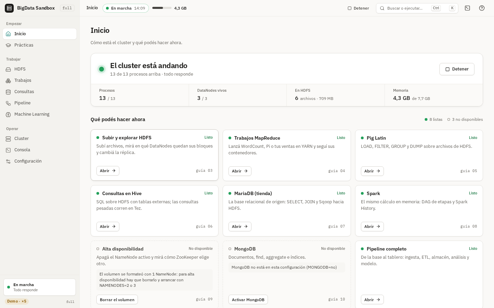
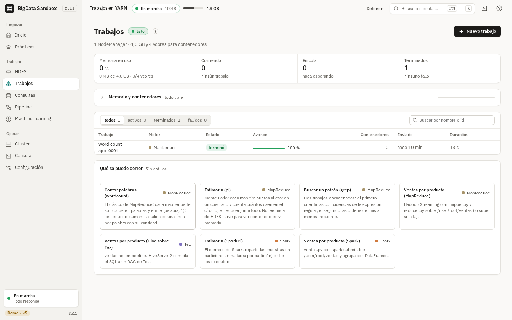
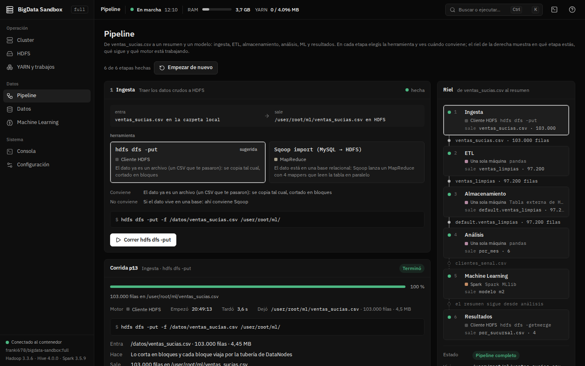
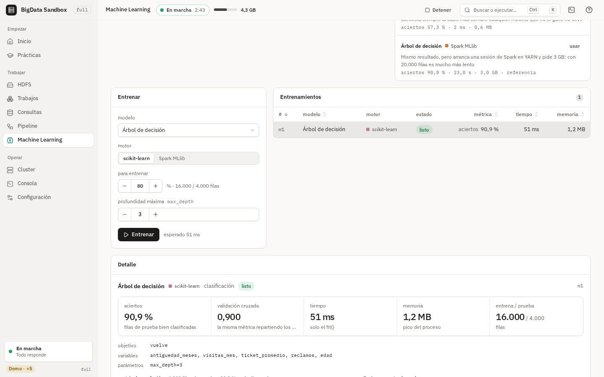
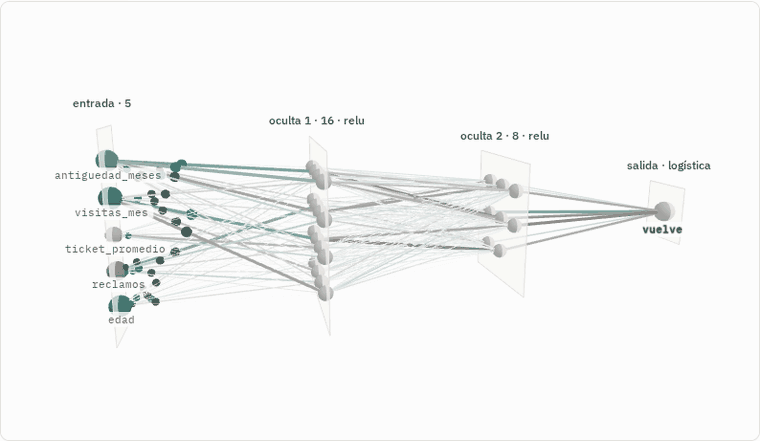
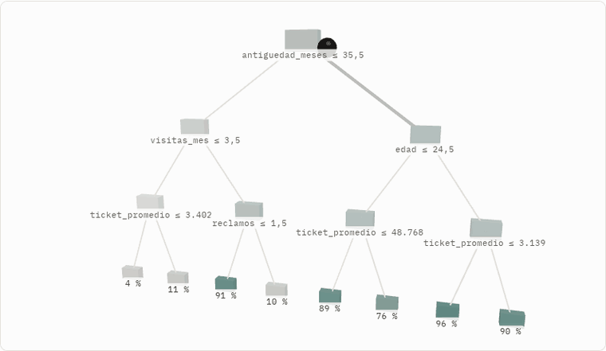
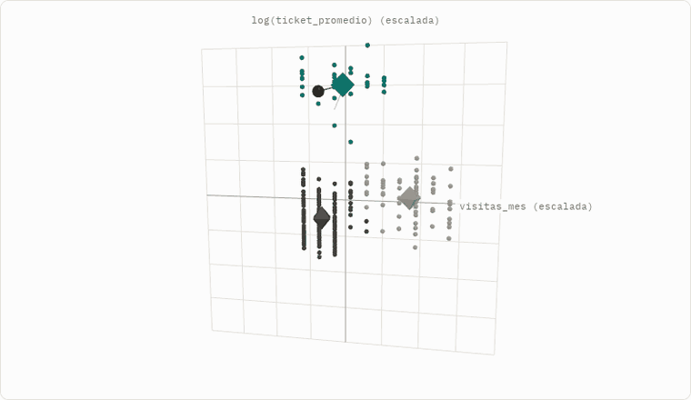
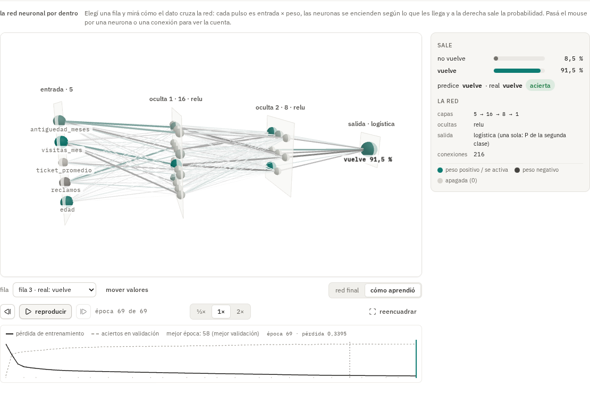

# BigData Sandbox

[Castellano](README.md) · **English**

A whole Big Data cluster in **one Docker image**: Hadoop (HDFS, YARN,
MapReduce), Hive, Spark, Pig, Sqoop with MySQL, ZooKeeper and MongoDB. Each
component runs as a separate process, with its own web page, and **you choose**
the HDFS architecture when you create the container: how many DataNodes and
NameNodes, how many replicas, how big the blocks are. No black box: it's real
Hadoop, on your computer.

- **[Guides](guias/README.md)** (in Spanish): from installing Docker to
  MongoDB, and for each version (`base`, `ml`, `full`, `empresa`) its
  step-by-step guides, reference, theory and assessment.
- **[Architecture map](https://franki-678.github.io/bigdata-sandbox/)**:
  each module of the cluster, what it does, how it connects to the others and
  its commands (also in the repo: `docs/index.html`).
- **[Demo of the `full` interface](https://franki-678.github.io/bigdata-sandbox/demo/)**:
  the web interface in your browser, with a simulated cluster (no Docker).


## Quick start

With Docker installed and 7 GB of RAM for Docker
([guide 1](guias/01-instalacion.md)), in a terminal open in an empty folder
(Mac/Linux; for PowerShell and CMD, see
[guide 2](guias/02-arrancar-y-apagar.md)):

```bash
docker pull franki678/bigdata-sandbox:base
docker run -d --name bigdata --stop-timeout 20 \
  -e DATANODES=3 -e REPLICATION=2 -e BLOCK_SIZE=1m -e MONGODB=si \
  -p 127.0.0.1:9870:9870 -p 127.0.0.1:9868:9868 -p 127.0.0.1:9901-9909:9901-9909 \
  -p 127.0.0.1:8088:8088 -p 127.0.0.1:8042:8042 -p 127.0.0.1:19888:19888 \
  -p 127.0.0.1:10000:10000 -p 127.0.0.1:10002:10002 \
  -p 127.0.0.1:18080:18080 -p 127.0.0.1:4040:4040 \
  -p 127.0.0.1:3306:3306 -p 127.0.0.1:27017:27017 \
  -v bigdata_hadoop:/hadoop -v "$(pwd)/datos:/datos" \
  franki678/bigdata-sandbox:base
docker logs -f bigdata
```

When it says *Cluster LISTO* (~1-2 minutes), `Ctrl+C` and get to work:

```bash
docker exec -it bigdata bash
```

Inside: `estado` shows each service and its web pages (HDFS at
http://localhost:9870, YARN at http://localhost:8088). To shut it down, from
your computer, `docker stop bigdata`; to come back, `docker start bigdata`.
The data stays in the `bigdata_hadoop` volume.

## Image versions

You choose the version with the *tag*, what goes after the colon:
`franki678/bigdata-sandbox:ml`. Without a tag, `latest` is used.

| Tag | Status | What's inside |
|---|---|---|
| `latest` = `base` | **Published. The one used in class** | Ubuntu 24.04 + Hadoop, Hive, Spark, Pig, Sqoop, MySQL, ZooKeeper and MongoDB. The one the guides use |
| `ml` | Published | `base` + Python for data (pandas, numpy, scikit-learn, matplotlib, pymongo) and JupyterLab, for ETL and machine learning |
| `full` | Published | `ml` + a web interface on port 8080 to start, configure and watch the cluster from the browser ([below](#the-full-version)) |
| `empresa` | Beta | `full` + several computers build a single cluster: the teacher's is the master and each PC adds a DataNode and a NodeManager, with one rack per row. It runs on a single computer (simulated classroom) and with the lab PCs over a WireGuard tunnel, with a small image for the PCs (`trabajador`) and the Classroom view; not yet tried in a real class ([guides](guias/empresa/README.md)) |

- Each version has its full documentation in [`guias/`](guias/README.md):
  step by step, reference, theory and assessment. Everything for `base`
  also applies to the other three (they are `base` with extras).
- The published ones work on Intel/AMD (amd64) and ARM (Mac M1–M4): Docker
  pulls the right one by itself.
- Until October 2026, `latest` was an older image on Ubuntu 20.04, without
  MongoDB. If you have it, see
  [Venís de la imagen anterior](guias/11-problemas.md#venís-de-la-imagen-anterior)
  (coming from the previous image).

### The `full` version

```bash
docker run -d --name bigdata-full --stop-timeout 20 \
  -p 127.0.0.1:8080:8080 -p 127.0.0.1:8888:8888 \
  -v bigdata_full:/hadoop -v "$(pwd)/datos:/datos" \
  franki678/bigdata-sandbox:full
```

Open http://localhost:8080 (JupyterLab, when enabled, is at
http://localhost:8888). As with `base`, the `datos/` folder on your
computer shows up inside as `/datos` (PowerShell: `"${PWD}/datos:/datos"`;
CMD: `"%cd%\datos:/datos"`): the examples are copied there when the cluster
starts (`/datos/ejemplos`), the Practices upload to HDFS from there, and what
you download with `hdfs dfs -get` lands in your folder. Without that `-v`
everything works the same, but the files stay inside the container. The container starts only the interface: the
cluster is chosen and started from there (*Iniciar*). With `-e AUTOSTART=1`
it starts by itself, with the usual variables (`DATANODES`, `REPLICATION`,
`SERVICIOS`...). To reach each service's web pages, add their ports as in the
[quick start](#quick-start). Server and API details in
[server/README.md](server/README.md). To look at it without installing
anything, there's the [demo](https://franki-678.github.io/bigdata-sandbox/demo/)
(a cluster simulated in the browser).

`Ctrl+`` ` (or the terminal icon, top right) opens a **terminal** into the
container inside the interface: bash in `/datos`, with `hdfs`, `hive`, `pig`,
`spark-submit` and the rest at hand, no `docker exec` needed. The Prácticas
(exercises) use it to *run each step in the terminal*. It only opens from the
same computer (`localhost`); `-e TERMINAL=0` turns it off.

The interface opens on **Inicio** (home): the cluster's state and what you
can do now, with what isn't available yet, why, and how to enable it. Every
screen (HDFS, Trabajos/jobs, Consultas/queries, Pipeline, Machine Learning,
Cluster) says, while the cluster is off or starting, what you'll be able to do
and how long is left; disabled buttons say why. **Prácticas** (practice) has
guides 03 to 10 step by step, checked against the cluster. The interface is in
Spanish.

| | |
|---|---|
|  |  |
| **Home**: what you can and can't do now, with the reason and the fix | **Jobs**: templates with parameters, progress, containers and logs |
|  |  |
| **Pipeline**: from a dirty CSV to a summary and a model, choosing the tool for each stage | **Machine Learning**: the same model with scikit-learn or with Spark MLlib, compared |

#### Inside each model

Below a trained model's detail, **por dentro** (inside) draws it in 3D from
what it actually learned (weights, splits, centers) and works out one row in front
of you. Pick a test row or move the inputs with sliders; play, pause, step and
speed controls on top; drag to orbit the camera and hover to see each neuron's
activation and each connection's weight and contribution.

- **Neural network** (both scikit-learn and MLlib): layers are planes and
  connections get thicker the more they weigh (teal when they add, ink when
  they subtract). The row goes in, pulses move layer by layer, active neurons
  light up and the probabilities come out on the right. In «cómo aprendió»
  (how it learned) the network rearranges epoch by epoch next to the loss curve.
- **Tree**: the row goes down the path, question by question, to its leaf.
- **KMeans**: points in 3D (PCA when there are more than 3 columns) and the
  centers moving iteration by iteration until they settle.
- **Linear and logistic regression**: the learned surface over two columns,
  with every point and its residual.

The browser's math gives exactly what the server predicted (the smoke test
compares them row by row, within 1e-6). With the system's «reduce motion» it
goes step by step; without WebGL it says why and the same math stays on the
side, as text.

| | |
|---|---|
|  |  |
| **Neural network**: one row's forward pass, layer by layer | **Tree**: the row's path to its leaf |
|  |  |
| **KMeans**: how the centers settle | **How it learned**: each epoch's weights and the loss curve |

The screenshots come from the [demo](https://franki-678.github.io/bigdata-sandbox/demo/);
the CI smoke test (`server/tests/humo/humo_ui.py`) takes the same screens
against the real image.

### What's in `base`

| Component | Version | What for |
|---|---|---|
| **HDFS**: NameNode(s), Secondary NameNode, 1 to 9 DataNodes | Hadoop 3.3.6 | Distributed file system |
| **YARN** + **MapReduce** + JobHistory | Hadoop 3.3.6 | Shares CPU and memory among jobs; the map/reduce model, in Java or in Python with Streaming |
| **Pig** | 0.18.0 | Pig Latin: process data step by step, translated to MapReduce |
| **Hive** (Metastore + HiveServer2, on Tez) | 4.0.0 (Tez 0.10.3) | SQL over HDFS files |
| **Spark** + PySpark + History Server | 3.5.9 | In-memory processing, on YARN; shares its tables with Hive |
| **Sqoop** + **MySQL** (MariaDB) with the `tienda` database | 1.4.7 / MariaDB 10.11 | Copy tables between a relational database and HDFS |
| **ZooKeeper** + JournalNodes + ZKFC | 3.8.7 | NameNode high availability (with `NAMENODES=2` or `3`) |
| **MongoDB** + `mongosh` with the `tienda` database | 8.0 | NoSQL document database (enabled with `MONGODB=si`) |

Also: Java 8 and Python 3.12. Hive and Spark share the metastore: a table
created in one is visible in the other.

## Requirements

Measured by GitHub on every new version of the image (Intel/AMD and ARM):

| | `base` | `base` + MongoDB | `ml` |
|---|---:|---:|---:|
| **RAM for Docker** (what you have to give it) | 6 GB | **7 GB** | 7 GB |
| RAM in use, idle | 2.0 GB | 2.1 GB | 2.2 GB |
| RAM in use, peak with jobs | 5.8 GB | 5.8 GB | 6.0 GB |
| Download (`docker pull` or the classroom file) | 1.36 GB | 1.36 GB | 1.58 GB |
| Disk, Linux | 2.23 GB | 2.23 GB | 2.93 GB |
| Disk, Docker Desktop (Windows/Mac) | ~3.6 GB | ~3.6 GB | ~4.5 GB |

- With high availability (`NAMENODES=2` or `3`): 8 GB of RAM. HDFS only
  (`SERVICIOS=hdfs`): 4 GB; HDFS + YARN (`SERVICIOS=mapreduce`): 5 GB.
- Docker Desktop stores the image both compressed and uncompressed: that's
  why it takes more space than on Linux.
- MongoDB needs an Intel/AMD processor with **AVX** (almost all since 2011)
  or a modern ARM. Without AVX everything works except MongoDB.
- On Windows, how much RAM Docker gets is set in `.wslconfig`
  ([guide 1](guias/01-instalacion.md#windows)).

## The guides

The guides are in Spanish. Each version has step-by-step guides, a
reference, theory and assessment: [`base`](guias/base/README.md) ·
[`ml`](guias/ml/README.md) · [`full`](guias/full/README.md) ·
[`empresa`](guias/empresa/README.md). The `base` guides, the starting point:

| # | Guide |
|---|---|
| 1 | [Installation: Docker and the image](guias/01-instalacion.md) (Windows, Mac, Linux; Docker Hub or the classroom file) |
| 2 | [Starting and stopping the cluster](guias/02-arrancar-y-apagar.md) (and every parameter) |
| 3 | [HDFS](guias/03-hdfs.md) |
| 4 | [YARN and MapReduce](guias/04-yarn-mapreduce.md) |
| 5 | [Pig](guias/05-pig.md) |
| 6 | [Hive](guias/06-hive.md) |
| 7 | [MySQL and Sqoop](guias/07-mysql-sqoop.md) |
| 8 | [Spark](guias/08-spark.md) |
| 9 | [ZooKeeper and high availability](guias/09-zookeeper-ha.md) |
| 10 | [MongoDB](guias/10-mongodb.md) |
| 11 | [Troubleshooting, coming from the previous image and starting from scratch](guias/11-problemas.md) |

The examples (`ventas.csv`, `texto.txt`, the Pig, Hive, Spark, Sqoop and
MongoDB scripts) come inside the image, in `/datos/ejemplos`: no need to clone
this repo.

## This repo

| File | What it is |
|---|---|
| `Dockerfile` | How the image is built, from the official Apache and MongoDB binaries |
| `entrypoint.sh`, `sandbox/` | Startup: generates the configuration from the parameters and starts each process. `sandbox/bin/` has the `estado`, `datanode`, `namenode` and `jps` commands |
| `conf/` | Fixed configuration (Hive, Spark, MySQL, MongoDB) |
| `datos/ejemplos/` | The examples that go inside the image |
| `docker-compose.yml` | The same cluster as guide 2, with `docker compose up -d` |
| `guias/` | The guides |
| `docs/` | The architecture map (GitHub Pages), the interface demo (`docs/demo/`, built with `npm run build:demo` in `ui/`) and the screenshots |
| `server/`, `ui/` | The server and the web interface of the `full` version |
| `pruebas/` | What GitHub runs before publishing |

## How it's tested

Every change goes through GitHub Actions before reaching Docker Hub:

- **`imagen.yml`** builds the image for amd64 and ARM, starts the cluster and
  runs `pruebas/probar.sh` (MapReduce, Pig, Hive, Spark and Sqoop have to
  produce the expected numbers), `pruebas/probar_mongodb.sh` and the scenarios
  in `pruebas/escenarios.sh`: restarts, high availability, failures, power
  cuts and volumes from the previous image. It also runs **every command in
  the guides** (`pruebas/tutoriales.py`) and compares the output with what
  they show. If anything fails, nothing is published.
- **`full.yml`** builds `full` and runs the API and interface smoke tests
  (Playwright, screen by screen, also with the cluster stopped) against real
  Hadoop, YARN, Hive, MySQL and MongoDB. `server.yml` runs the server tests.
- **`docs.yml`**: when only the guides or the map change, it checks the
  links, that the demo in `docs/demo/` matches `ui/`, and runs the guides
  again against the published image.
- **`aula.yml`** leaves the image as a file in the
  [`imagen`](https://github.com/Franki-678/bigdata-sandbox/releases/tag/imagen)
  release, to hand it out in the classroom without every computer downloading
  it from the internet.

## Notes

- It's a sandbox for learning: it runs as root, with no HDFS permissions or
  security. It's not for real data.
- All the nodes are processes on the same machine and share the disk. The
  mechanics of blocks, replicas, failures and failover are real Hadoop; if
  the computer shuts down, everything goes down together.
- To fit in a laptop, each process has a small memory cap
  (`sandbox/lib.sh`), MySQL and MongoDB use little cache (`conf/`) and the
  image doesn't ship what the cluster doesn't use.

## License

[Apache 2.0](LICENSE). The changes in each version are in the
[CHANGELOG](CHANGELOG.md) (in Spanish).
