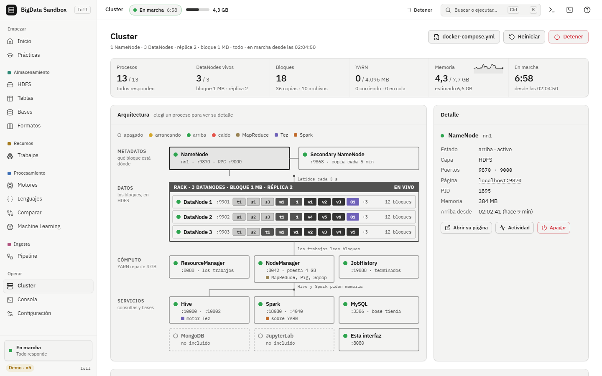

# BigData Sandbox

**Castellano** · [English](README.en.md)

Un cluster de Big Data entero en **una imagen de Docker**, para aprender con el Hadoop de verdad en
tu compu: HDFS, YARN, MapReduce, Hive, Spark, Pig, Sqoop con MySQL, ZooKeeper y MongoDB. Cada
componente corre como un proceso aparte, con su propia página web, y la arquitectura de HDFS **la
elegís vos** al crear el contenedor: cuántos DataNodes y NameNodes, cuántas réplicas, de qué tamaño
los bloques. Se puede apagar un DataNode y ver cómo HDFS re-copia los bloques, o tirar el NameNode
activo y ver cómo otro toma el control.

La misma imagen viene en cuatro versiones (*tags*), cada una con lo de la anterior más algo:

| Tag | Estado | Qué agrega | Documentación |
|---|---|---|---|
| [`base`](#base) (= `latest`) | Publicada. **La de la materia** | El cluster: Hadoop, Hive, Spark, Pig, Sqoop, MySQL, ZooKeeper y MongoDB | [docs/base](docs/base/README.md) |
| [`ml`](#ml) | Publicada | Python para datos (pandas, scikit-learn, XGBoost, matplotlib, pymongo), Spark MLlib y JupyterLab | [docs/ml](docs/ml/README.md) |
| [`full`](#full) | Publicada | Una interfaz web (puerto 8080) para prender, configurar y mirar el cluster, con prácticas y un estudio de ML | [docs/full](https://github.com/Franco-SanMartin/bigdata-sandbox/tree/main/docs/full) |
| [`empresa`](#empresa) | Beta | Varias compus arman un solo cluster: la del profe es el maestro y cada PC del aula suma nodos | [docs/empresa](https://github.com/Franco-SanMartin/bigdata-sandbox/tree/main/docs/empresa) |

- **[Mapas interactivos](https://franco-sanmartin.github.io/bigdata-sandbox/)**: cada versión dibujada
  pieza por pieza, cómo se conecta cada cosa y cómo se usa (también en el repo:
  [`docs/index.html`](docs/index.html), anda sin internet).
- **[Demo de la interfaz `full`](https://franco-sanmartin.github.io/bigdata-sandbox/demo/)**: la
  interfaz web en el navegador, con un cluster simulado (sin Docker).
- **[Glosario](docs/glosario.md)**: cada término (bloque, réplica, NameNode, executor...) en una
  línea.

## Contenido

- [Arranque rápido](#arranque-rápido)
- [Qué versión uso](#qué-versión-uso)
- [Requisitos](#requisitos)
- [La documentación](#la-documentación)
- [Este repo](#este-repo)
- [Cómo se prueba](#cómo-se-prueba)
- [Notas](#notas)
- Por versión: [base](#base) · [ml](#ml) · [full](#full) · [empresa](#empresa)

## Arranque rápido

Con Docker instalado y 7 GB de RAM para Docker, en una terminal parada en una carpeta vacía (Mac y
Linux; PowerShell, CMD y el resto del paso a paso en la [guía de `base`](docs/base/guia.md)):

```bash
docker run -d --name bigdata --stop-timeout 20 \
  -e DATANODES=3 -e REPLICATION=2 -e BLOCK_SIZE=1m -e MONGODB=si \
  -p 127.0.0.1:9870:9870 -p 127.0.0.1:9868:9868 -p 127.0.0.1:9901-9909:9901-9909 \
  -p 127.0.0.1:8088:8088 -p 127.0.0.1:8042:8042 -p 127.0.0.1:19888:19888 \
  -p 127.0.0.1:10000:10000 -p 127.0.0.1:10002:10002 \
  -p 127.0.0.1:18080:18080 -p 127.0.0.1:4040:4040 \
  -p 127.0.0.1:3306:3306 -p 127.0.0.1:27017:27017 \
  -v bigdata_hadoop:/hadoop -v "$(pwd)/datos:/datos" \
  franki678/bigdata-sandbox:base
docker logs -f bigdata
```

Cuando el log diga **Cluster LISTO**, `Ctrl+C` y a trabajar adentro:

```bash
docker exec -it bigdata bash
```

Adentro, `estado` muestra cada servicio y su página web (HDFS en http://localhost:9870, YARN en
http://localhost:8088). Para apagar, desde tu compu, `docker stop bigdata`; para volver,
`docker start bigdata`. Los datos quedan en el volumen `bigdata_hadoop` y tu carpeta `datos/` es
`/datos` adentro.

## Qué versión uso

- **Para la materia, `base`.** Es la de las clases y la más liviana. En el aula se reparte como
  archivo, sin que cada compu la baje de internet ([guía de `base`, parte 3](docs/base/guia.md#3-tener-la-imagen)).
- **Para ETL y machine learning, `ml`.** Lo mismo que `base` más Python para datos y JupyterLab.
- **Para mirar el cluster sin terminal, `full`.** Una interfaz web con todo lo de `ml`, prácticas
  guiadas y un estudio de ML con pantallas.
- **Para un laboratorio con varias PCs, `empresa`.** Un cluster repartido entre las compus del aula.

Lo de `base` vale igual en las otras tres: son `base` con agregados. Todas las publicadas sirven para
Intel/AMD (amd64) y ARM (Mac M1 a M4): Docker baja sola la que corresponde. La versión va después de
los dos puntos (`franki678/bigdata-sandbox:ml`); sin tag se usa `latest`, que es `base`.

## Requisitos

Medidos por el workflow `Imagen` en cada versión nueva, con `docker stats` y 2 DataNodes (detalle en
el README de cada versión):

| | `base` | `base` + MongoDB | `ml` |
|---|---:|---:|---:|
| **RAM para Docker** | 6 GB | **7 GB** | 7 GB |
| En uso, en reposo | 2,0 GB | 2,1 GB | 2,2 GB |
| En uso, pico con trabajos | 5,8 GB | 5,8 GB | 6,0 GB |
| Descarga | 1,36 GB | 1,36 GB | 1,58 GB |
| Disco, Linux | 2,23 GB | 2,23 GB | 2,93 GB |
| Disco, Docker Desktop | ~3,6 GB | ~3,6 GB | ~4,5 GB |

MongoDB necesita un procesador Intel/AMD con AVX o un ARM moderno: sin AVX anda todo menos MongoDB.
Los requisitos de `full` y `empresa` están en su documentación.

## La documentación

Cada versión tiene su carpeta en [`docs/`](docs/) con lo mismo:

| Archivo | Qué es |
|---|---|
| `README.md` y `.pdf` | Qué es la versión, qué trae, qué hace y qué no, cómo está hecha y cómo se prueba |
| `guia.md` y `.pdf` | El paso a paso para usarla, con los resultados esperados |
| `interactivo.html` | El mapa: cada pieza, con qué se conecta, sus comandos y recorridos paso a paso. Un solo archivo, sin red |

Los PDF y los HTML se generan desde los `.md` y un `interactivo.json` con
[`docs/_herramientas`](docs/_herramientas/README.md). Los comandos de la guía de `base` los corre
GitHub contra la imagen antes de publicarla: si la guía y la imagen no coinciden, no se publica.

## Este repo

| Archivo | Qué es |
|---|---|
| `Dockerfile` | Cómo se arma la imagen: una etapa por versión (`base`, `ml`, `full`, `empresa`), desde los binarios oficiales de Apache y de MongoDB |
| `entrypoint.sh`, `sandbox/` | El arranque: genera la configuración según los parámetros y prende cada proceso. `sandbox/bin/` tiene `estado`, `datanode`, `namenode`, `jps` y `topologia` |
| `conf/` | Configuración fija (Hive, Spark, MySQL, MongoDB, JupyterLab) y las librerías de `ml` |
| `datos/` | Los ejemplos que van adentro de la imagen ([datos/README.md](datos/README.md)) |
| `ml/` | `sandbox_ml`, el estudio de ML de `ml` y `full` |
| `server/`, `ui/` | El servidor y la interfaz web de `full` |
| `empresa/`, `sonda/` | El cluster del aula y la sonda para probar la red del laboratorio |
| `docker-compose.yml` | El cluster de la guía con `docker compose up -d` |
| `docs/` | La documentación de cada versión, los mapas, la demo de `full` (`docs/demo/`, se arma con `npm run build:demo` en `ui/`) y las capturas |
| `pruebas/` | Lo que corre GitHub antes de publicar |
| [`CHANGELOG.md`](CHANGELOG.md), [`DECISIONES.md`](DECISIONES.md), [`HOJA-DE-RUTA.md`](HOJA-DE-RUTA.md) | Los cambios de cada versión, por qué se decidió cada cosa y lo que sigue |

## Cómo se prueba

Cada cambio pasa por GitHub Actions antes de llegar a Docker Hub:

- **`imagen.yml`** arma `base` y `ml` para amd64 y ARM y corre los escenarios de
  `pruebas/escenarios.sh`: MapReduce, Pig, Hive, Spark y Sqoop tienen que dar los números esperados,
  y además reinicios, alta disponibilidad, caídas, cortes de golpe, volúmenes de la imagen anterior,
  la prueba de `ml` y **todos los comandos de la guía de `base`** (`pruebas/tutoriales.py`). Si algo
  falla, no se publica.
- **`full.yml`** arma `full` y le corre el humo de la API y de la interfaz contra un cluster real.
  `server.yml` corre los tests del servidor. **`empresa.yml`** prueba el cluster del aula.
- **`docs.yml`**: cuando cambia la documentación, revisa los links y las marcas de prueba de las
  guías, que la demo sea la de `ui/`, y vuelve a correr la guía de `base` contra la imagen publicada.
- **`aula.yml`** deja `base` como archivo en el release
  [`imagen`](https://github.com/Franco-SanMartin/bigdata-sandbox/releases/tag/imagen), para repartirla
  en el aula.

## Notas

- Es un sandbox para aprender: corre como root, sin permisos en HDFS ni seguridad. No es para datos
  reales, y los puertos se publican sólo en `127.0.0.1`.
- Todos los nodos son procesos en la misma máquina y comparten el disco. La mecánica de bloques,
  réplicas, caídas y failover es la real de Hadoop; si se apaga la compu, se apaga todo junto (salvo
  en `empresa`, donde los nodos están en compus distintas).
- Para que entre en una notebook, cada proceso tiene un tope de memoria chico (`sandbox/lib.sh`),
  MySQL y MongoDB usan poca caché y la imagen no trae lo que el cluster no usa.
- Licencia [Apache 2.0](LICENSE).

---

## base

`franki678/bigdata-sandbox:base` (= `latest`). El cluster entero en un contenedor:

| Pieza | Versión |
|---|---|
| HDFS, YARN, MapReduce | Hadoop 3.3.6 |
| Hive (sobre Tez 0.10.3) | 4.0.0 |
| Spark (PySpark, sobre YARN) | 3.5.9 |
| Pig | 0.18.0 |
| Sqoop + MySQL (MariaDB 10.11) | 1.4.7 |
| ZooKeeper (alta disponibilidad) | 3.8.7 |
| MongoDB | 8.0 |

De 1 a 9 DataNodes y de 1 a 3 NameNodes, replicación y tamaño de bloque a elección, con
`docker run -e ...`. Comandos propios para simular fallas (`datanode stop 2`, `namenode stop 1`).
Ejemplos que dan siempre los mismos números, para comparar entre alumnos y entre herramientas.
También viene como archivo para el aula (release `imagen`).

[README](docs/base/README.md) ([PDF](docs/base/README.pdf)) · [Guía de uso](docs/base/guia.md)
([PDF](docs/base/guia.pdf)) · [Mapa interactivo](docs/base/interactivo.html)

## ml

`franki678/bigdata-sandbox:ml`. Todo lo de `base` más:

- **Python para datos**, con versiones fijas: pandas 2.3.3, numpy 1.26.4, scikit-learn 1.9.1,
  XGBoost 3.1.1 (sin GPU), matplotlib, pymongo.
- **Spark MLlib** desde cualquier `python3`, corriendo en YARN.
- **JupyterLab** en http://localhost:8888 (publicando el puerto 8888), mirando tu carpeta `datos/`.
- **Ejemplos de punta a punta**: datos sucios limpiados con pandas y con Spark (dan los mismos
  números), y modelos de scikit-learn y Spark MLlib que encuentran las reglas con las que se
  generaron los datos.
- **`sandbox_ml`**: experimentos reproducibles desde un notebook (receta → script → registro →
  biblioteca de modelos → predicción por lotes).

[README](docs/ml/README.md) ([PDF](docs/ml/README.pdf)) · [Guía de uso](docs/ml/guia.md)
([PDF](docs/ml/guia.pdf)) · [Mapa interactivo](docs/ml/interactivo.html)

## full

`franki678/bigdata-sandbox:full`. Todo lo de `ml` más una **interfaz web** en el puerto 8080: el
cluster se elige, se prende y se mira desde el navegador (HDFS, trabajos de YARN, consultas,
pipeline, machine learning), con una terminal adentro de la interfaz y prácticas guiadas paso a paso.

```bash
docker run -d --name bigdata-full --stop-timeout 20 \
  -p 127.0.0.1:8080:8080 -p 127.0.0.1:8888:8888 \
  -v bigdata_full:/hadoop -v "$(pwd)/datos:/datos" \
  franki678/bigdata-sandbox:full
```

Y abrir http://localhost:8080. Para mirarla sin instalar nada:
[demo](https://franco-sanmartin.github.io/bigdata-sandbox/demo/).



Documentación: [docs/full](https://github.com/Franco-SanMartin/bigdata-sandbox/tree/main/docs/full) ·
servidor y API: [server/README.md](server/README.md).

## empresa

`franki678/bigdata-sandbox:empresa` (beta). Todo lo de `full`, repartido entre las compus del aula:
la del profe es el maestro (NameNode, ResourceManager, Hive, Spark History y la interfaz) y cada PC
suma un DataNode y un NodeManager, con racks por fila. Las PCs se conectan por un túnel WireGuard y
usan una imagen chica (`franki678/bigdata-sandbox:empresa-trabajador`). También anda en una sola compu, como aula simulada.

Documentación: [docs/empresa](https://github.com/Franco-SanMartin/bigdata-sandbox/tree/main/docs/empresa) ·
[empresa/LEEME.md](empresa/LEEME.md).
