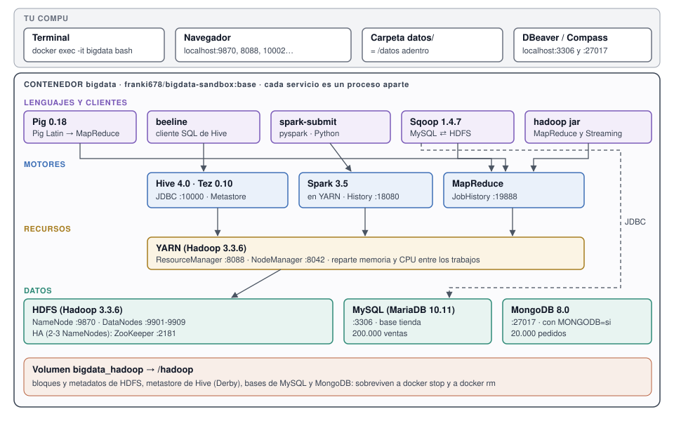

# Versión `base`

`franki678/bigdata-sandbox:base` (en Docker Hub, `latest` es la misma imagen): todo el ecosistema
Hadoop de una materia de Big Data en **un contenedor**, con cada servicio como proceso aparte y su
página web. La arquitectura de HDFS (cuántos DataNodes y NameNodes, replicación, tamaño de bloque)
se elige en el `docker run`. Es la versión de la que salen las demás: `ml`, `full` y `empresa` son
`base` con cosas agregadas.

[Guía de uso](guia.md) · [Mapa interactivo](interactivo.html) · [Glosario](../glosario.md) ·
[README del proyecto](../../README.md)

## Contenido

- [Qué es](#qué-es)
- [Qué trae](#qué-trae)
- [Qué hace y qué no](#qué-hace-y-qué-no)
- [Requisitos](#requisitos)
- [Arranque rápido](#arranque-rápido)
- [Parámetros](#parámetros)
- [Puertos](#puertos)
- [Comandos propios](#comandos-propios)
- [Los datos de ejemplo](#los-datos-de-ejemplo)
- [El paquete del aula](#el-paquete-del-aula)
- [Cómo está hecha](#cómo-está-hecha)
- [Cómo se prueba](#cómo-se-prueba)

## Qué es

Un cluster de Hadoop de verdad (no una simulación) que corre en una sola compu. Adentro del
contenedor, cada pieza es su propio proceso Java: el NameNode, cada DataNode, el ResourceManager,
HiveServer2... Por eso se puede apagar un DataNode y ver cómo HDFS re-copia los bloques, o apagar el
NameNode activo y ver cómo otro toma el control, igual que en un cluster de varias máquinas.



- **HDFS** guarda los archivos partidos en bloques, cada bloque copiado en varios DataNodes.
- **YARN** reparte la memoria y el CPU entre los trabajos.
- **MapReduce, Hive (sobre Tez) y Spark** procesan lo que está en HDFS. **Pig** escribe trabajos
  MapReduce en un lenguaje de pasos.
- **Sqoop** copia tablas entre MySQL y HDFS. **MongoDB** es la base NoSQL, aparte del cluster.
- **ZooKeeper** elige el NameNode activo cuando hay alta disponibilidad (2 o 3 NameNodes).
- El volumen `/hadoop` guarda todo lo que tiene que sobrevivir; la carpeta `/datos` es tu carpeta de
  la compu.

## Qué trae

Las versiones salen del `Dockerfile` (los `ARG ..._VERSION` y la imagen de partida).

| Pieza | Versión | Para qué |
|---|---|---|
| Ubuntu | 24.04 (`eclipse-temurin:8-jdk-noble`) | El sistema del contenedor |
| Java | 8 (Temurin, JDK) | Hadoop, Hive, Spark. JDK y no JRE porque Sqoop compila una clase por tabla |
| Hadoop | 3.3.6 | HDFS, YARN, MapReduce, Hadoop Streaming |
| Hive | 4.0.0 | SQL sobre HDFS: Metastore + HiveServer2 + beeline |
| Tez | 0.10.3 | El motor con el que Hive corre las consultas |
| Spark | 3.5.9 | PySpark sobre YARN, con acceso a las tablas de Hive |
| Pig | 0.18.0 | Pig Latin → MapReduce (o local) |
| Sqoop | 1.4.7 | MySQL ⇄ HDFS por JDBC (driver MySQL 5.1.49) |
| ZooKeeper | 3.8.8 | Sólo con `NAMENODES` 2 o 3 |
| MySQL | MariaDB 10.11 (de Ubuntu) | La base relacional `tienda`, para Sqoop |
| MongoDB | 8.0 (`mongod` + `mongosh`) | La base de documentos `tienda`, con `MONGODB=si` |
| Python | 3.12 (sin librerías de datos) | PySpark, Hadoop Streaming, los scripts de ejemplo |

Imagen para Intel/AMD (amd64) y ARM (arm64, Mac M1 a M4): Docker elige sola.

## Qué hace y qué no

**Hace:**

- Arma el cluster que pidas al crear el contenedor: de 1 a 9 DataNodes, de 1 a 3 NameNodes,
  replicación y tamaño de bloque a elección.
- Prende todo en orden y avisa con **Cluster LISTO** cuando se puede usar. La primera vez formatea
  HDFS, crea las carpetas, sube a HDFS las librerías de Tez y Spark, y carga las bases MySQL y
  MongoDB.
- Apaga en orden con `docker stop` (MySQL, MongoDB, Hive, YARN y HDFS, en 20 s) para no cortar
  escrituras.
- Deja simular fallas: `datanode stop N` y `namenode stop N`.
- Guarda todo en un volumen: se puede borrar el contenedor y crearlo con otros parámetros sin
  perder los datos.
- Trae ejemplos que dan siempre el mismo resultado, para comparar entre alumnos y entre herramientas.

**No hace:**

- **No tiene seguridad**: sin contraseñas en las páginas, HDFS sin permisos reales, MySQL con
  `alumno`/`alumno`. Por eso los puertos van con `127.0.0.1`: sólo se ven desde tu compu. No lo
  expongas a una red.
- **No es para producción** ni para datos grandes: es un cluster de enseñanza en una compu. Los
  DataNodes comparten el mismo disco.
- **No es un cluster de varias PCs**: todos los nodos están en un contenedor. El cluster del aula,
  con cada PC como nodo, es la versión [`empresa`](../../README.md#empresa).
- **No trae pandas, scikit-learn ni JupyterLab**: eso es la versión [`ml`](../ml/README.md).
- **No tiene interfaz web propia** para crear y manejar el cluster: eso es la versión
  [`full`](../../README.md#full).
- **MongoDB necesita AVX** en Intel/AMD (o un ARM moderno). Sin AVX, el arranque avisa y sigue sin
  MongoDB.
- No trae HBase, Kafka, Flume, Oozie ni Impala.

## Requisitos

Medidos por el workflow `Imagen` del repo en cada versión nueva, con `docker stats` y 2 DataNodes.
*Reposo*: 30 s después del LISTO. *Pico*: mientras corren las pruebas.

| | `base` | `base` + MongoDB |
|---|---|---|
| RAM para Docker | 6 GB | 7 GB |
| En reposo | 2,0 GB | 2,1 GB |
| Pico | 5,8 GB | 5,8 GB |
| Descarga | 1,36 GB | 1,36 GB |
| Disco (Linux) | 2,23 GB | 2,23 GB |
| Disco (Docker Desktop) | ~3,6 GB | ~3,6 GB |

Con `SERVICIOS=hdfs` alcanza con 4 GB; con `mapreduce`, 5 GB. Alta disponibilidad (`NAMENODES=2`),
8 GB. Cada DataNode extra suma ~250 MB.

## Arranque rápido

```bash
docker run -d --name bigdata --stop-timeout 20 \
  -e DATANODES=3 -e REPLICATION=2 -e BLOCK_SIZE=1m -e MONGODB=si \
  -p 127.0.0.1:9870:9870 -p 127.0.0.1:9868:9868 -p 127.0.0.1:9901-9909:9901-9909 \
  -p 127.0.0.1:8088:8088 -p 127.0.0.1:8042:8042 -p 127.0.0.1:19888:19888 \
  -p 127.0.0.1:10000:10000 -p 127.0.0.1:10002:10002 \
  -p 127.0.0.1:18080:18080 -p 127.0.0.1:4040:4040 \
  -p 127.0.0.1:3306:3306 -p 127.0.0.1:27017:27017 \
  -v bigdata_hadoop:/hadoop -v "$(pwd)/datos:/datos" \
  franki678/bigdata-sandbox:base
docker logs -f bigdata          # esperar "Cluster LISTO"
docker exec -it bigdata bash    # entrar
```

O con el [`docker-compose.yml`](../../docker-compose.yml) del repo: `docker compose up -d`. Las
versiones para PowerShell y CMD, y todo paso a paso, en la [guía](guia.md#4-crear-el-cluster).

## Parámetros

Variables de entorno del `docker run` (`-e NOMBRE=valor`). Las valida `sandbox/lib.sh` al arrancar:
si una está mal, el contenedor se apaga con `[sandbox] ERROR: ...` en el log.

| Parámetro | Por defecto | Valores | Qué cambia |
|---|---|---|---|
| `DATANODES` | `1` | `1`-`9` | Cantidad de DataNodes |
| `REPLICATION` | `1` | `1`-`9` | Copias de cada bloque (si es mayor que `DATANODES`, los bloques quedan sub-replicados) |
| `BLOCK_SIZE` | `128m` | `1m` o más (`m`/`g`) | Tamaño de bloque de HDFS |
| `NAMENODES` | `1` | `1`-`3` | Con 2 o 3: alta disponibilidad (JournalNodes, ZKFC, ZooKeeper). **Queda fijo en el volumen** |
| `SERVICIOS` | `todo` | `hdfs`, `mapreduce`, `todo` | `hdfs`: sólo HDFS. `mapreduce`: + YARN, JobHistory y MySQL. `todo`: + Hive y Spark |
| `MONGODB` | `no` | `si`, `no` | Prende MongoDB con la base `tienda` |
| `PIG_HEAPSIZE` | `512` | MB | Memoria del cliente `pig` |

El [`docker-compose.yml`](../../docker-compose.yml) usa `DATANODES=3`, `REPLICATION=2`,
`BLOCK_SIZE=1m` y `MONGODB=si`: bloques chicos para ver muchos con archivos chicos.

## Puertos

Todos con `127.0.0.1` en el `docker run`: sólo desde tu compu.

| Puerto | Qué | Cuándo |
|---|---|---|
| 9870 (9871, 9872) | Web del NameNode (uno por NameNode) | Siempre |
| 9868 | Web del Secondary NameNode | Con 1 NameNode |
| 9901-9909 | Web de cada DataNode (DataNode N → 990N) | Siempre |
| 9000 | RPC de HDFS (para clientes de afuera) | Siempre; publicarlo es opcional |
| 8480-8482 | Web de los JournalNodes | Con 2-3 NameNodes |
| 8088 | Web de YARN (ResourceManager) | `mapreduce` o `todo` |
| 8042 | Web del NodeManager | `mapreduce` o `todo` |
| 19888 | Web del JobHistory (MapReduce terminados) | `mapreduce` o `todo` |
| 9083 | Hive Metastore (Thrift) | `todo`; publicarlo es opcional |
| 10000 | HiveServer2 (JDBC, para beeline o DBeaver) | `todo` |
| 10002 | Web de HiveServer2 | `todo` |
| 18080 | Spark History | `todo` |
| 4040 | Web del trabajo de Spark que está corriendo | Mientras corre |
| 3306 | MySQL (`alumno`/`alumno`, base `tienda`) | `mapreduce` o `todo` |
| 27017 | MongoDB | `MONGODB=si` |

Adentro también están ZooKeeper (2181) y los ZKFC (8019-8021), sin página web.

## Comandos propios

En `/opt/sandbox/bin`, primeros en el `PATH` del contenedor:

| Comando | Qué hace |
|---|---|
| `estado` | Cada proceso, si está arriba, su página web y la versión de la imagen |
| `datanode` | Lista los DataNodes. `datanode stop N` lo apaga (el NameNode lo da por muerto a los ~40 s); `datanode start N` lo prende, o suma uno nuevo si N es mayor que `DATANODES` |
| `namenode` | Lista los NameNodes y cuál está *active*. `namenode stop N` / `namenode start N` |
| `jps` | Como el de Java, pero dice qué instancia es cada proceso (`DataNode (dn2)`) |
| `topologia` | No es para usar a mano: con él la versión `empresa` le dice al NameNode en qué fila (rack) está cada PC |

## Los datos de ejemplo

Se copian a `/datos/ejemplos` en cada arranque, sin pisar lo que ya tengas. Salen de
[`datos/ejemplos/`](../../datos/ejemplos/).

| Archivo | Qué es |
|---|---|
| `ventas.csv` | 8 ventas, para ver el formato |
| `generar_ventas.py` | Genera `ventas_grandes.csv`: 200.000 ventas de un almacén, siempre las mismas |
| `mapper.py`, `reducer.py` | Ventas por producto con MapReduce (Hadoop Streaming) |
| `texto.txt`, `wordcount.pig` | Contar palabras con Pig |
| `ventas.pig`, `ventas.hql`, `ventas.py` | Ventas por producto con Pig, Hive y Spark |
| `tienda.sql` | La base MySQL `tienda` (la carga el primer arranque) |
| `tienda.hql`, `sqoop.sh` | Ida y vuelta MySQL → HDFS → Hive → MySQL |
| `tienda_mongo.js`, `consultas_mongo.js` | La base MongoDB `tienda` y consultas con su SQL equivalente |

El mismo cálculo (unidades y facturación por producto) da lo mismo con MapReduce, Pig, Hive y Spark:
la yerba vende 179.512 unidades y factura 448.780.000. Con eso se compara una herramienta con otra.

## El paquete del aula

En un aula, 20 PCs bajando 1,4 GB a la vez saturan la red y Docker Hub corta las descargas sin
cuenta. Por eso `base` también se publica como **un solo archivo**, `bigdata-sandbox.tar.gz`, en el
release [`imagen`](https://github.com/Franco-SanMartin/bigdata-sandbox/releases/tag/imagen) del repo:
la PC del profesor lo baja una vez y lo reparte (Veyon, pendrive o la red local).

Lo arma el workflow `Aula` (`.github/workflows/aula.yml`), a mano desde `main`:

1. Baja la `base` publicada para amd64 (las PCs del aula son Intel/AMD).
2. `docker save` con un solo nombre, `franki678/bigdata-sandbox:base`, y lo comprime.
3. Lo prueba de punta a punta: lo sirve por HTTP, lo baja, hace `docker load` en un Docker limpio y
   verifica que la imagen cargada diga `SANDBOX_VERSION=base`.
4. Lo sube al release `imagen` reemplazando el anterior, con las notas de
   `.github/release-imagen.md`.

Cómo usarlo en el aula: [guía, parte 3](guia.md#b-en-el-aula-el-archivo-de-la-imagen). No hay
archivo para ARM.

## Cómo está hecha

**El `Dockerfile`** tiene varias etapas; `base` es el `--target base` (y lo que se arma sin
`--target`):

1. **`hadoop-dist` y `descargas`**: bajan los paquetes oficiales de Apache (de la CDN, y si ya no
   están, del archivo histórico con reintentos) y les sacan lo que un cluster en marcha no usa
   (documentación, SDK de S3, código fuente, conectores a sistemas que no hay). Hive se verifica con
   su sha256 y, si Apache no contesta, se baja de una copia en un release del repo. Corren en el
   procesador de quien arma: al armar amd64 y arm64 se bajan una sola vez.
2. **`base`**: parte de `eclipse-temurin:8-jdk-noble` (Java 8 sobre Ubuntu 24.04), instala `tini`,
   Python 3, MariaDB y MongoDB (de su repositorio oficial), copia lo bajado, la configuración de
   [`conf/`](../../conf/), los comandos de [`sandbox/`](../../sandbox/) y los ejemplos.

**El arranque** es [`entrypoint.sh`](../../entrypoint.sh), con las funciones de
[`sandbox/lib.sh`](../../sandbox/lib.sh). `tini` es el proceso 1 (recoge los procesos que se
apagan). En orden:

1. Valida los parámetros y genera `hdfs-site.xml` y los demás archivos según la arquitectura pedida.
2. HDFS: formatea la primera vez (con HA, primero los JournalNodes y ZooKeeper), prende NameNodes y
   DataNodes, espera a que se anoten y sale del *safe mode*. Crea `/tmp`, `/user/root`,
   `/user/hive/warehouse`, `/apps/tez`, `/apps/spark` y `/spark-logs`.
3. YARN (ResourceManager, NodeManager, JobHistory) y MySQL, si `SERVICIOS` no es `hdfs`. La primera
   vez crea la base `tienda` con las 200.000 ventas.
4. MongoDB, si `MONGODB=si` y el procesador puede (la primera vez carga `tienda`).
5. Hive y Spark, si `SERVICIOS=todo`: sube las librerías de Tez y Spark a HDFS, prepara el metastore
   (Derby, en el volumen), prende Metastore, HiveServer2 y Spark History, y espera el puerto 10000.
6. Muestra **Cluster LISTO** y el `estado`. Al recibir `docker stop`, apaga todo en orden.

## Cómo se prueba

Cada cambio pasa por el workflow `Imagen` antes de publicarse:

- **Escenarios** (`pruebas/escenarios.sh`, en amd64 y arm64): reinicios, alta disponibilidad con
  failover, cada valor de `SERVICIOS`, parámetros inválidos, MongoDB, apagado en orden, volúmenes de
  la imagen anterior y cortes de golpe. También mide la RAM de la tabla de [requisitos](#requisitos).
- **Tutoriales** (`pruebas/tutoriales.py`): corre cada comando de la [guía](guia.md), en orden, y
  verifica la salida esperada. Si la guía y la imagen no coinciden, no se publica.
- Recién con todo verde, publica `base`, `latest` y `ml` para amd64 y arm64 y verifica lo publicado.

Los cambios de esta versión: [CHANGELOG](../../CHANGELOG.md). Por qué se decidió cada cosa:
[DECISIONES](../../DECISIONES.md).
