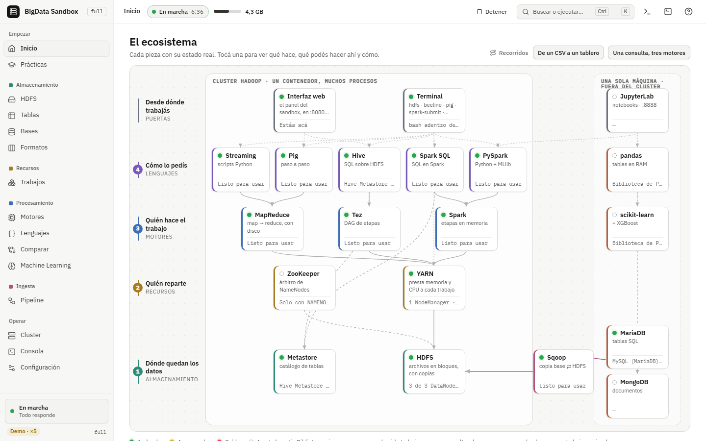
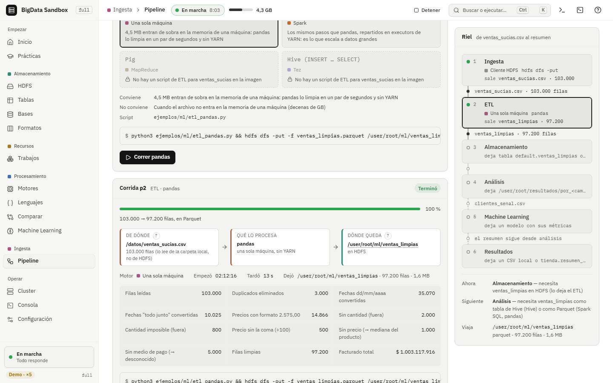

# full: el cluster con interfaz web

`franki678/bigdata-sandbox:full` es la imagen más completa para usar en una sola compu. Trae todo lo de **base** (Hadoop, Hive, Tez, Spark, Pig, Sqoop, ZooKeeper, MariaDB y MongoDB) y todo lo de **ml** (Python con pandas, scikit-learn, PySpark y Jupyter). Encima suma una **interfaz web en el puerto 8080**: desde el navegador manejás el cluster, mirás HDFS y YARN, corrés consultas, comparás motores, armás un pipeline de punta a punta, entrenás modelos y hacés las prácticas con autoevaluación.

| Archivo | Para qué |
|---|---|
| [README.md](README.md) / [README.pdf](README.pdf) | Este documento: qué es, cómo está hecha, qué hace y qué no |
| [guia.md](guia.md) / [guia.pdf](guia.pdf) | Paso a paso: de bajar la imagen a usar cada pantalla |
| [interactivo.html](interactivo.html) | Mapa clickeable de las piezas y cómo se conectan (se abre sin internet) |



## Qué es

Es un contenedor que corre un cluster Hadoop completo en una sola máquina y lo expone con una interfaz web. La interfaz es un programa en Python (Starlette + uvicorn) que lanza los comandos de verdad dentro del contenedor (`hdfs`, `yarn`, `beeline`, `spark-submit`, `pig`, `sqoop`, `mysql`, `mongosh`) y le devuelve al navegador lo que pasa. **No es una simulación:** si en la interfaz subís un archivo a HDFS, queda en HDFS, y lo podés ver con `hdfs dfs -ls` desde la terminal.

Sirve para cursar Big Data sin instalar nada aparte de Docker: el alumno ve las piezas, las prende y las apaga, y lee en la misma pantalla qué comando corrió cada botón.

## Cómo se desarrolló

La imagen sale de un único `Dockerfile` con varias etapas. Cada tag es una etapa que se apoya en la anterior:

```text
descargas ──► base ──► ml ──► full ──► empresa
                                ▲
interfaz (node, compila la UI) ─┘
```

- **base** (desde `eclipse-temurin:8-jdk-noble`) baja Hadoop, Hive, Tez, Spark, ZooKeeper, Pig y Sqoop, verifica sus sumas y les pone la configuración de `conf/`.
- **ml** le suma Python y las librerías de `conf/requirements-ml.txt`, más la librería propia `ml/sandbox_ml` (el motor del estudio de ML).
- **interfaz** es una etapa aparte, sobre `node:22-bookworm-slim`, que sólo compila la UI de `ui/` a archivos estáticos (`ui/dist`). De esa etapa no queda Node en la imagen final.
- **full** parte de ml y agrega:
  - el servidor `server/sandbox_server`, con sus dependencias fijadas en `server/requirements.txt`;
  - la UI ya compilada en `/opt/sandbox/ui`;
  - los ejemplos de la pantalla Comparar.

  Por último deja `EXPOSE 8080` y arranca con `tini → python3 -m sandbox_server`.

La UI se desarrolló en paralelo con un **modo demo** (`npm run build:demo`, que se publica en `docs/demo/`). Ese modo tiene los mismos textos y validaciones que el servidor real, así que cada pantalla se pudo diseñar y probar sin levantar el cluster. El servidor real devuelve las mismas formas de datos que el demo; el contrato está en `ui/API.md`.

Las pruebas automáticas están en el workflow `.github/workflows/full.yml`. Para cada push a `main` que toca código:

1. Arma la imagen en amd64 y en arm64.
2. Le corre la prueba de humo: la API, la interfaz con Playwright y el chequeo de que con `AUTOSTART=1` arranca sola y `docker stop` la apaga en orden.
3. Si todo pasa, publica `:full`.

Las corridas medidas de ese workflow tardaron 53 min 47 s (run 42894896304) y 57 min 44 s el job más largo (run 42896926516). Según el estado relevado, la última `:full` publicada salió el 10/11/2026 del commit 2a759f8.

## Herramientas y versiones

| Pieza | Versión | De dónde |
|---|---|---|
| Java | Temurin 8 (JDK) | imagen `eclipse-temurin:8-jdk-noble` |
| Hadoop (HDFS, YARN, MapReduce) | 3.3.6 | `Dockerfile` |
| Hive (HiveServer2 + Metastore) | 4.0.0 | `Dockerfile`, sha256 verificado |
| Tez | 0.10.3 | `Dockerfile` |
| Spark | 3.5.9 | `Dockerfile` |
| ZooKeeper | 3.8.7 | `Dockerfile` |
| Pig | 0.18.0 | `Dockerfile` |
| Sqoop | 1.4.7 | `Dockerfile` |
| MariaDB | la de Ubuntu 24.04 | `apt` |
| MongoDB | 8.0 | repositorio de MongoDB |
| Python + ML | pandas, scikit-learn, PySpark, Jupyter | `conf/requirements-ml.txt` |
| Servidor web | starlette 1.9.0, uvicorn 0.54.0, python-multipart 0.0.32, wsproto 1.3.2 | `server/requirements.txt` |
| Interfaz | React 19.3.0, Vite 7.3.7, TypeScript 5.9.3 | `ui/package.json` |
| Librerías de la UI | CodeMirror 6 (editor), xterm 6.0.0 (terminal), radix-ui, cmdk (paleta), d3 (gráficos), three (3D), lucide (íconos), IBM Plex Sans/Mono | `ui/package.json` |
| Pruebas de la UI | vitest 4.1.12, Playwright (en CI) | `ui/package.json`, `full.yml` |

## Qué hace

### La interfaz, pantalla por pantalla

El menú lateral tiene seis grupos. Cada pantalla se abre también con una tecla, y la paleta de comandos busca entre todas.

| Grupo | Pantalla | Tecla | Qué hacés ahí |
|---|---|---|---|
| Empezar | **Inicio** | `i` | Estado del cluster, botón Iniciar/Apagar, servicios arriba y abajo |
| | **Prácticas** | `r` | 9 prácticas guiadas con autoevaluación |
| Almacenamiento | **HDFS** | `h` | Explorador de archivos: subir, bajar, mover, réplicas, `fsck`, DataNodes |
| | **Tablas** | `t` | Catálogo de Hive, esquema, consultas y `EXPLAIN` |
| | **Bases** | `b` | MariaDB y MongoDB |
| | **Formatos** | `f` | El mismo dato en CSV, Parquet y ORC: tamaño y velocidad |
| Recursos | **Trabajos** | `y` | Aplicaciones de YARN, su avance, sus logs y botón para matarlas |
| Procesamiento | **Motores** | `e` | La misma consulta en MapReduce, Tez y Spark |
| | **Lenguajes** | `l` | El mismo cálculo en Hive y en Pig |
| | **Comparar** | `k` | Código lado a lado de cada herramienta |
| | **ML** | `m` | Estudio de machine learning paso a paso |
| Ingesta | **Pipeline** | `p` | Ventas sucias → limpias → almacén → análisis → modelo → resultados |
| Operar | **Cluster** | `c` | Topología y procesos (prender/apagar cada uno) |
| | **Consola** | `o` | Lo que imprimió cada acción |
| | **Config** | `s` | DataNodes, réplicas, bloque, servicios; genera el docker-compose |

Además hay un **cajón de terminal** (una bash real dentro del contenedor), un cajón de consola y una hoja de ayuda con los atajos.

### Prácticas

Son las mismas de la cursada, con sus pasos y preguntas de autoevaluación (`ui/src/lib/practicas`):

| Práctica | Qué se hace |
|---|---|
| HDFS: subir, mirar y replicar | `mkdir`, `put`, `ls`, `cat`, pedir 3 copias, `fsck`, bajar el archivo |
| HDFS: se cae un DataNode | Apagar un DataNode, esperar que lo den por muerto, ver los bloques sub-replicados, volver a prenderlo |
| MapReduce: contar palabras | Lanzar el wordcount, seguirlo en YARN, leer los logs y el resultado |
| Pig: las ventas en Pig Latin | `LOAD`, `FILTER`/`FOREACH`, `GROUP`/`SUM` |
| Hive: SQL sobre HDFS | Tabla externa, agrupar con Tez, `EXPLAIN` |
| MariaDB y Sqoop | De la base a HDFS con Sqoop |
| Spark: el mismo cálculo en memoria | SparkPi, DataFrames, el DAG |
| Alta disponibilidad | Se cae el NameNode activo y toma el control el otro |
| MongoDB: documentos e índices | `findOne`, `find` con filtros, índices |

### Pipeline

El pipeline lleva `ventas_sucias.csv` de punta a punta en seis etapas. En cada etapa elegís con qué herramienta hacerla, y cada paso corre de verdad (`server/sandbox_server/pipeline.py`):

| Etapa | Herramientas que podés elegir |
|---|---|
| Ingesta | `hdfs dfs -put` · Sqoop import (MySQL → HDFS) |
| ETL | pandas · PySpark · Pig |
| Almacenamiento | Tabla externa de Hive · Archivos Parquet en HDFS |
| Análisis | Hive (Tez) · Spark SQL · pandas |
| Machine Learning | scikit-learn · Spark MLlib (regresión, clasificación o clustering) |
| Resultados | `hdfs dfs -getmerge` · Sqoop export (HDFS → MySQL) |



### Estudio de ML

El estudio de ML te lleva de un dataset a un modelo entrenado, paso a paso:

1. Datos
2. Objetivo
3. Limpieza
4. Preproceso
5. Modelo
6. Validación
7. Entrenar
8. Código

Después siguen las vistas de Resultados, Experimentos y Biblioteca (modelos guardados y predicción), y el **Generador** de datasets a escala. Los datos se leen de HDFS. Los modelos corren en scikit-learn (en una sola compu) o en Spark MLlib (sobre YARN), y la pantalla Código te muestra el script equivalente.

### Seguridad de la interfaz

La interfaz controla un cluster como root, por eso tiene tres barreras (`server/sandbox_server/seguridad.py`):

1. **Sólo responde a hosts confiables:** `localhost`, `127.0.0.1` y `::1`, más lo que agregues en `SANDBOX_HOSTS`. Así corta el *DNS rebinding*.
2. **En cada pedido que cambia algo** (POST, PUT, PATCH, DELETE), el `Origin` o el `Referer` tiene que ser del mismo sitio.
3. **Los cuerpos tienen que ser JSON.** La única excepción es la subida de archivos a HDFS (multipart).

Además, el ejemplo de `docker run` publica los puertos sólo en `127.0.0.1`: desde otra máquina de la red no se llega.

La terminal web (`server/sandbox_server/terminal.py`) es una bash de root parada en `/datos`, con un máximo de 4 sesiones a la vez. Se apaga con `-e TERMINAL=0`.

### Variables de entorno

| Variable | De fábrica | Qué hace |
|---|---|---|
| `AUTOSTART` | `0` | Con `1`, el cluster arranca solo, sin esperar al botón Iniciar |
| `DATANODES` | `1` | Cuántos DataNodes levanta (de 1 a 9) |
| `REPLICATION` | `1` | Copias de cada bloque |
| `BLOCK_SIZE` | `128m` | Tamaño de bloque de HDFS |
| `NAMENODES` | `1` | Con `2` o `3`, alta disponibilidad (con ZooKeeper). Queda fija al crear el volumen |
| `SERVICIOS` | `todo` | Qué se prende además de HDFS: `hdfs` (nada más), `mapreduce` (YARN + MapReduce) o `todo` |
| `MONGODB` | no | Prende MongoDB |
| `JUPYTER` | sí | Jupyter en el puerto 8888 |
| `PIG_HEAPSIZE` | `512` | Memoria (MB) de Pig |
| `TERMINAL` | prendida | Con `0`, apaga la terminal web |
| `SANDBOX_HOSTS` | vacío | Hosts extra que la interfaz acepta |

Todo esto también se cambia desde la pantalla **Config**, que además estima la memoria que vas a necesitar. Docker Desktop trae un tope de unos 7,9 GB. Esa pantalla también arma el `docker-compose.yml` listo para copiar, con el contenedor `bigdata-full`, el volumen `bigdata_full` y los puertos en `127.0.0.1`.

### Puertos

| Puerto | Qué es |
|---|---|
| 8080 | **La interfaz** |
| 9870 | NameNode (HDFS) |
| 8088 | ResourceManager (YARN) |
| 19888 | JobHistory (MapReduce) |
| 10000 / 10002 | HiveServer2 / su web |
| 18080 / 4040 | Spark History / la app Spark en curso |
| 8888 | Jupyter |
| 27017 | MongoDB |

## Qué NO hace

- **No es un cluster de varias máquinas.** Todo corre en un contenedor. Para repartirlo entre las PCs de un aula está la imagen [empresa](../empresa/README.md).
- **No es para exponer a internet.** No tiene usuarios ni contraseñas: la protección es que escuche sólo en `127.0.0.1`. Si publicás el 8080 hacia afuera, cualquiera que llegue maneja el cluster como root.
- **No es una simulación.** Los tiempos y los errores son los del Hadoop real. Si a Docker le falta memoria, los trabajos fallan de verdad.
- **No reemplaza las UIs nativas.** La interfaz resume lo que muestran el NameNode (9870), YARN (8088) y Spark History (18080), pero esas webs siguen ahí, con todo el detalle.
- **No guarda modelos ni datos fuera del volumen.** Si borrás el volumen `bigdata_full`, se va todo lo que había en HDFS.

## Limitaciones conocidas

- **Necesita memoria.** Con los servicios de fábrica conviene darle a Docker 6–8 GB. La pantalla Config estima cuánto ocupa cada combinación, pero es una estimación, no una medición en tu compu.
- **El primer arranque es lento,** porque formatea HDFS y prepara la base de Hive. No está medido en esta documentación.
- **El modo demo de la UI** (`docs/demo/`) muestra datos fijos. Sirve para mirar las pantallas, no para practicar.
- **Imagen grande.** Trae Hadoop, Spark, Hive, Python con ML y MongoDB. La imagen [base](../base/README.md) es la más liviana si no necesitás la interfaz.
- **arm64:** la imagen se arma y se prueba también para arm64 (Mac con chip Apple) en `full.yml`.

## Dónde está cada cosa en el repo

| Ruta | Qué hay |
|---|---|
| `Dockerfile` (etapas `interfaz` y `full`) | Cómo se arma |
| `server/sandbox_server/` | El servidor: `app.py` (rutas), `config.py`, `hdfs.py`, `yarn.py`, `pipeline.py`, `ml.py`, `terminal.py`, `seguridad.py` |
| `ui/` | La interfaz (React). `ui/API.md` es el contrato con el servidor |
| `datos/ejemplos/`, `datos/comparar/` | Datasets y scripts de ejemplo |
| `conf/` | Configuración de Hadoop, Hive, Spark, etc. |
| `.github/workflows/full.yml` | Armado, prueba de humo y publicación |
