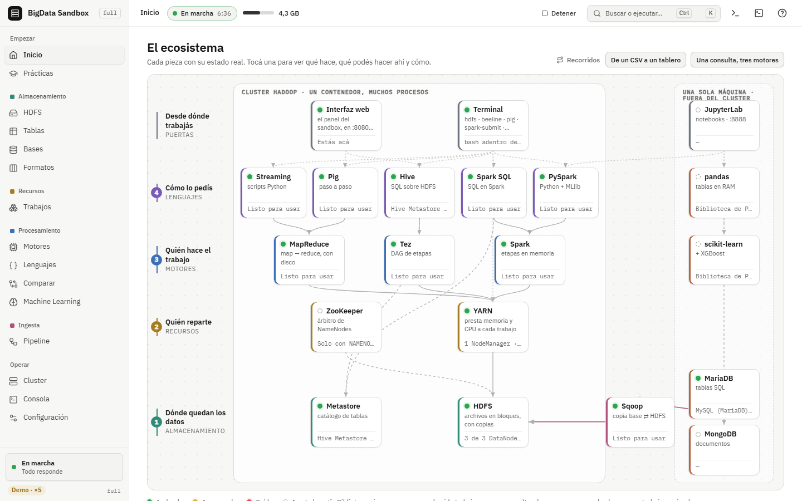
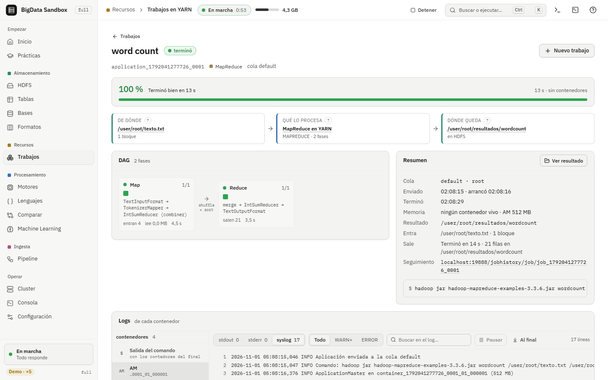
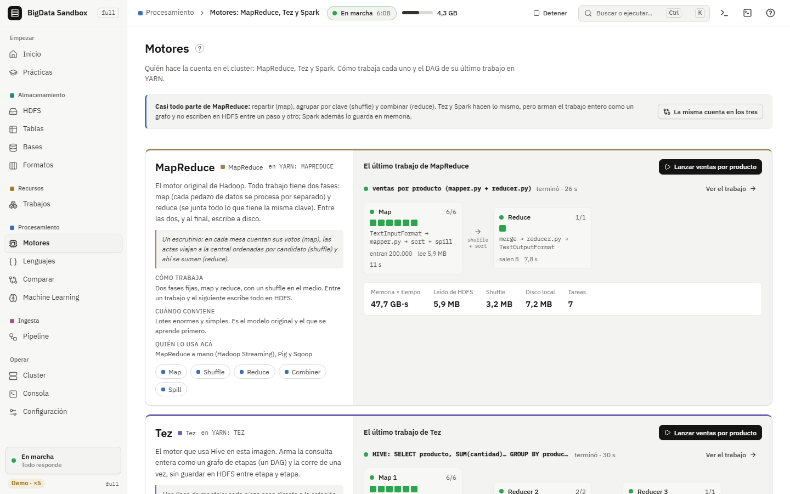
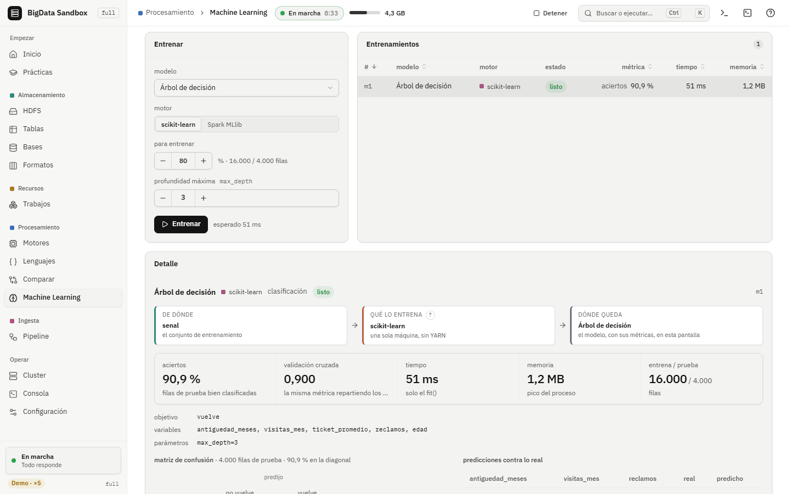

# Guía de full: de cero a usar cada pantalla

Esta guía te lleva de una compu con Docker a usar la interfaz web de `franki678/bigdata-sandbox:full`, pantalla por pantalla. Para saber qué es cada pieza y cómo está hecha, mirá el [README](README.md). Para ver cómo se conecta todo, abrí el [mapa interactivo](interactivo.html).

Los comandos llevan, antes, un comentario invisible (`<!-- prueba: ... -->`) que usa `pruebas/tutoriales.py` para probarlos. No hace falta que lo copies.

## 1. Lo que necesitás

- **Docker Desktop** (Windows o Mac) o Docker Engine (Linux). Anda en amd64 y en arm64 (Mac con chip Apple).
- **Memoria para Docker:** 6 a 8 GB. En Docker Desktop: *Settings → Resources → Memory*. Con menos, prendé menos servicios (lo ves en el paso 9).
- **Disco:** la imagen trae Hadoop, Spark, Hive, Python con ML y MongoDB. Dejá varios GB libres.
- Un navegador moderno (Chrome, Edge, Firefox o Safari).

## 2. Bajar la imagen

<!-- prueba: no (baja la imagen full de Docker Hub) -->
```bash
docker pull franki678/bigdata-sandbox:full
```

## 3. Arrancar el contenedor

Abrí una terminal en una carpeta tuya; ahí va a quedar la subcarpeta `datos`, compartida con el contenedor.

En Linux, Mac o Git Bash:

<!-- prueba: no (necesita el contenedor bigdata-full) -->
```bash
docker run -d --name bigdata-full --stop-timeout 20 \
  -p 127.0.0.1:8080:8080 -p 127.0.0.1:8888:8888 \
  -v bigdata_full:/hadoop -v "$(pwd)/datos:/datos" \
  franki678/bigdata-sandbox:full
```

En PowerShell de Windows:

<!-- prueba: no (PowerShell de Windows) -->
```powershell
docker run -d --name bigdata-full --stop-timeout 20 `
  -p 127.0.0.1:8080:8080 -p 127.0.0.1:8888:8888 `
  -v bigdata_full:/hadoop -v "${PWD}/datos:/datos" `
  franki678/bigdata-sandbox:full
```

Qué hace cada parte:

| Parte | Para qué |
|---|---|
| `--name bigdata-full` | El nombre con el que lo vas a manejar |
| `--stop-timeout 20` | Le da 20 s a `docker stop` para apagar todo en orden (si no, Docker lo corta a los 10 s) |
| `-p 127.0.0.1:8080:8080` | La interfaz, sólo para tu compu |
| `-p 127.0.0.1:8888:8888` | Jupyter |
| `-v bigdata_full:/hadoop` | Volumen donde queda HDFS: sobrevive a borrar el contenedor |
| `-v "$(pwd)/datos:/datos"` | Tu carpeta `datos`, que adentro se ve como `/datos` |

Si también querés las webs nativas, sumá `-p 127.0.0.1:9870:9870` (HDFS), `-p 127.0.0.1:8088:8088` (YARN), `-p 127.0.0.1:19888:19888` (JobHistory) y `-p 127.0.0.1:18080:18080` (Spark History).

> **Importante:** dejá siempre el `127.0.0.1:` delante del puerto. La interfaz no tiene contraseña y maneja el cluster como root.

## 4. Abrir la interfaz e iniciar el cluster

1. Abrí **http://localhost:8080**.
2. En **Inicio** el cluster aparece apagado: la imagen trae `AUTOSTART=0`, así que espera a que vos decidas.
3. Tocá **Iniciar**. La consola muestra cada servicio que se prende: NameNode, DataNode, ResourceManager, NodeManager, JobHistory, MariaDB, Hive y Spark History.
4. Cuando todos los servicios están en verde, el cluster está listo.

Si preferís que arranque solo, agregá `-e AUTOSTART=1` al `docker run`.



## 5. Confirmar desde la terminal

La interfaz tiene un **cajón de terminal**: una bash real adentro del contenedor, parada en `/datos`. También podés entrar desde tu compu:

<!-- prueba: no (necesita el contenedor bigdata-full) -->
```bash
docker exec -it bigdata-full bash
```

Adentro, `estado` muestra cada proceso, si está arriba y su web:

<!-- prueba: adentro | espera: NameNode -->
```bash
estado
```

`jps` lista los procesos Java:

<!-- prueba: adentro | espera: NameNode | espera: DataNode -->
```bash
jps
```

Y el informe de HDFS:

<!-- prueba: adentro | espera: Live datanodes -->
```bash
hdfs dfsadmin -report
```

## 6. HDFS (tecla `h`)

La pantalla HDFS es un explorador de archivos sobre el HDFS de verdad.

1. Entrá a `/user/root` y creá una carpeta con **Nueva carpeta**.
2. **Subir** manda un archivo de tu compu a HDFS. También podés tomar uno de `/datos`, por ejemplo `/datos/ejemplos/ventas.csv`.
3. Tocá el archivo para ver sus primeras líneas, sus bloques y en qué DataNode está cada uno.
4. **Réplicas** cambia cuántas copias se guardan. Con un solo DataNode, pedir 3 deja los bloques sub-replicados: es justo lo que se ve en `fsck`.
5. **fsck** revisa la salud del sistema de archivos.

Lo mismo desde la terminal:

<!-- prueba: adentro | espera: ventas.csv -->
```bash
hdfs dfs -mkdir -p /user/root/guia
hdfs dfs -put -f /datos/ejemplos/ventas.csv /user/root/guia/
hdfs dfs -ls /user/root/guia
```

<!-- prueba: adentro | espera: HEALTHY -->
```bash
hdfs fsck /user/root/guia
```

## 7. Trabajos de YARN (tecla `y`)

Cada vez que algo corre en el cluster (un MapReduce, una consulta de Hive con Tez, un Spark), aparece como aplicación de YARN. En **Trabajos** ves su avance, su cola, los contenedores que usa y sus logs, y lo podés matar.

Para ver uno, lanzá el wordcount de ejemplo:

<!-- prueba: adentro | espera: SUCCEEDED -->
```bash
hdfs dfs -mkdir -p /user/root/guia/texto
hdfs dfs -put -f /datos/ejemplos/texto.txt /user/root/guia/texto/
hdfs dfs -rm -r -f /user/root/guia/conteo
yarn jar $HADOOP_HOME/share/hadoop/mapreduce/hadoop-mapreduce-examples-*.jar \
  wordcount /user/root/guia/texto /user/root/guia/conteo
yarn application -list -appStates FINISHED
```

Las métricas del cluster, como las lee la interfaz:

<!-- prueba: adentro | espera: activeNodes -->
```bash
curl -s http://localhost:8088/ws/v1/cluster/metrics
```



## 8. Prácticas (tecla `r`)

En **Prácticas** están las nueve de la cursada:

1. HDFS: subir, mirar y replicar.
2. HDFS: se cae un DataNode.
3. MapReduce.
4. Pig.
5. Hive.
6. MariaDB y Sqoop.
7. Spark.
8. Alta disponibilidad.
9. MongoDB.

Cómo se hace cada una:

1. Elegí una práctica. Cada paso trae la explicación y el comando.
2. Tocá **Correr en la terminal** (o **Ejecutar**). El comando va a la terminal y el resultado aparece debajo; si te trabás, están **Una pista** y **Ver una solución**.
3. Al final, las **preguntas de autoevaluación** te dicen qué entendiste y qué conviene repasar.

Algunas prácticas necesitan una configuración especial y te lo avisan en el primer paso. *Se cae un DataNode* pide 2 o más DataNodes, *Alta disponibilidad* pide 2 NameNodes y *MongoDB* pide MongoDB prendido. Eso se cambia en Config (paso 9).

## 9. Config (tecla `s`): cambiar la forma del cluster

En **Config** elegís:

- **DataNodes** (de 1 a 9), **réplicas** y **tamaño de bloque**;
- **NameNodes:** con 2 o 3 hay alta disponibilidad: si el activo se cae, ZooKeeper promueve al que está en espera;
- **servicios:** sólo HDFS, HDFS + YARN/MapReduce, o todo;
- **MongoDB** y **Jupyter**.

Mientras cambiás, la pantalla **estima la memoria** y te avisa si te pasás del tope de Docker. **Aplicar** reinicia el cluster con la configuración nueva.

La cantidad de NameNodes queda fija al crear el volumen. Para cambiarla, la pantalla te manda a la sección **Empezar de cero**, que borra el volumen (y con él, HDFS).

El botón **Ver docker-compose.yml** te da el `docker-compose.yml` equivalente, para levantar siempre la misma configuración sin entrar a la interfaz.

## 10. Tablas, Bases y Formatos

- **Tablas (`t`)**: el catálogo de Hive. Elegí una tabla para ver su esquema, escribí una consulta y correla, o pedí su `EXPLAIN` para ver el plan de Tez.
- **Bases (`b`)**: MariaDB, con la base `tienda` de ejemplo, y MongoDB, si está prendido.
- **Formatos (`f`)**: el mismo dataset guardado en CSV, Parquet y ORC. Compará cuánto ocupa cada uno y cuánto tarda la misma consulta.

La misma consulta desde la terminal, con beeline:

<!-- prueba: adentro | espera: default -->
```bash
beeline -u jdbc:hive2://localhost:10000 -n root -e "SHOW DATABASES;"
```

## 11. Motores, Lenguajes y Comparar

- **Motores (`e`)**: lanza la misma agregación en **MapReduce**, **Tez** y **Spark**, y te deja los tiempos lado a lado. Es para ver por qué Tez y Spark ganan: menos escrituras intermedias a disco.
- **Lenguajes (`l`)**: el mismo cálculo escrito en **Hive** (SQL) y en **Pig** (Pig Latin).
- **Comparar (`k`)**: el código de cada herramienta lado a lado (MapReduce en Python, Pig, Hive, Spark, Sqoop), sacado de `datos/ejemplos` y `datos/comparar`.



## 12. Pipeline (tecla `p`)

El pipeline lleva `ventas_sucias.csv` de punta a punta. En cada etapa elegís la herramienta y tocás **Correr**:

| Etapa | Qué hace | Opciones |
|---|---|---|
| Ingesta | Trae los datos crudos a HDFS | `hdfs dfs -put` o Sqoop desde MySQL |
| ETL | Limpia (fechas, montos, duplicados) | pandas, PySpark o Pig |
| Almacenamiento | Deja los datos limpios consultables | Tabla externa de Hive o Parquet |
| Análisis | Agrupa por sucursal, producto, mes o medio de pago | Hive (Tez), Spark SQL o pandas |
| Machine Learning | Entrena con `clientes_senal.csv` | scikit-learn o Spark MLlib |
| Resultados | Saca el resumen | `getmerge` a un archivo o Sqoop a MySQL |

Cada etapa avisa qué necesita de la anterior. Por ejemplo, Almacenamiento necesita `ventas_limpias`, que deja el ETL. Lo que imprime cada paso queda en la **Consola** (`o`).

## 13. ML (tecla `m`)

El estudio de ML se recorre en orden:

1. **Datos:** elegí un dataset de HDFS o generá uno. Ves su perfil: columnas, tipos, nulos y distribución.
2. **Objetivo:** qué columna querés predecir. La pantalla deduce si es regresión, clasificación o clustering.
3. **Limpieza** y **Preproceso:** qué hacer con nulos, outliers y categorías. Cada opción explica su efecto.
4. **Modelo:** te recomienda modelos según el problema y el tamaño de los datos.
5. **Validación:** train/test o validación cruzada.
6. **Entrenar:** corre en scikit-learn o en Spark MLlib, sobre YARN.
7. **Código:** el script equivalente, para llevártelo.

Después, en **Resultados** ves las métricas y en **Experimentos** comparás corridas. La **Biblioteca** guarda los modelos para predecir con datos nuevos y avisa si los datos cambiaron (*deriva*). El **Generador** arma datasets grandes para probar a escala.

Jupyter está en **http://localhost:8888**, con los ejemplos de `/datos/ejemplos/ml`.



## 14. Cluster y Consola

- **Cluster (`c`)**: la topología, con cada proceso, su estado y su web. Podés apagar y prender procesos sueltos: apagá un DataNode y mirá qué pasa con los bloques.
- **Consola (`o`)**: el registro de cada acción, con el comando que corrió y lo que imprimió.

## 15. Apagar, volver y empezar de cero

Para apagar sin perder nada, usá el botón **Apagar** de Inicio y después:

<!-- prueba: no (necesita el contenedor bigdata-full) -->
```bash
docker stop bigdata-full
```

Para volver, prendé el contenedor y tocá **Iniciar**. HDFS sigue en el volumen:

<!-- prueba: no (necesita el contenedor bigdata-full) -->
```bash
docker start bigdata-full
```

Para empezar de cero borrás el contenedor y el volumen. **Se pierde todo lo que había en HDFS.**

<!-- prueba: no (borra el contenedor y el volumen de full) -->
```bash
docker rm -f bigdata-full
docker volume rm bigdata_full
```

## 16. Si algo falla

| Síntoma | Qué mirar |
|---|---|
| La página no carga | `docker ps`: el contenedor tiene que estar *Up*. Mirá `docker logs bigdata-full` |
| «La interfaz solo se abre desde esta compu (localhost)…» | Entrá por `localhost` o `127.0.0.1`. Si a propósito usás otro nombre, agregalo con `-e SANDBOX_HOSTS=nombre` |
| Un servicio no prende | La Consola muestra el error. Casi siempre es memoria: subila en Docker o apagá servicios en Config |
| Los trabajos quedan en ACCEPTED | YARN no tiene memoria libre: mirá Trabajos y matá lo que sobre |
| La terminal no abre | Hay como máximo 4 a la vez. Si arrancaste con `TERMINAL=0`, está apagada |
