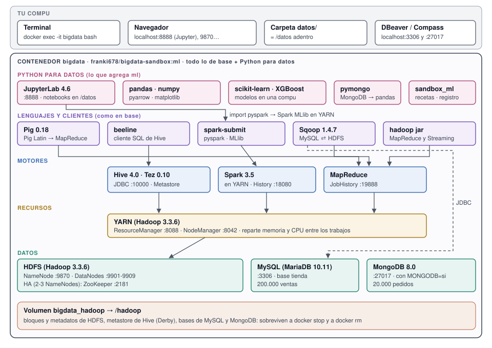

# Versión `ml`

`franki678/bigdata-sandbox:ml`: la versión [`base`](../base/README.md) entera (el mismo cluster, los
mismos parámetros, los mismos comandos) más **Python para datos**: pandas, scikit-learn, XGBoost,
matplotlib y pymongo, **Spark MLlib** desde cualquier `python3`, y **JupyterLab** en el navegador.
Es para la parte de la materia que va de datos sucios a modelos: ETL, machine learning con una
librería de una compu (scikit-learn) y con una distribuida (Spark MLlib).

[Guía de uso](guia.md) · [Mapa interactivo](interactivo.html) · [README de `base`](../base/README.md) ·
[Glosario](../glosario.md) · [README del proyecto](../../README.md)

## Contenido

- [Qué es](#qué-es)
- [Qué agrega a base](#qué-agrega-a-base)
- [Qué hace y qué no](#qué-hace-y-qué-no)
- [Requisitos](#requisitos)
- [Arranque rápido](#arranque-rápido)
- [Parámetros y puertos](#parámetros-y-puertos)
- [JupyterLab](#jupyterlab)
- [Los ejemplos](#los-ejemplos)
- [sandbox_ml: el estudio de ML](#sandbox_ml-el-estudio-de-ml)
- [Cómo está hecha](#cómo-está-hecha)
- [Cómo se prueba](#cómo-se-prueba)

## Qué es

Todo lo de `base` (HDFS, YARN, MapReduce, Hive, Spark, Pig, Sqoop, MySQL, MongoDB, ZooKeeper) sigue
igual, y encima:



- **JupyterLab** (puerto 8888) abre notebooks y terminales adentro del contenedor, desde el navegador.
  Sus archivos son los de `/datos`, tu carpeta de la compu.
- Las **librerías de Python** corren en el contenedor, en la memoria de una compu: pandas para el ETL,
  scikit-learn y XGBoost para los modelos, matplotlib para los gráficos, pymongo para leer MongoDB.
- **PySpark** se importa desde cualquier `python3` (un notebook, un script), no sólo con
  `spark-submit`. Los trabajos corren en YARN, como en `base`, y **Spark MLlib** entrena repartido en
  el cluster.
- **`sandbox_ml`** es una librería propia que arma experimentos reproducibles: una receta en JSON se
  convierte en un script de scikit-learn o de PySpark, y cada corrida queda registrada en el volumen.

## Qué agrega a base

Las versiones salen de [`conf/requirements-ml.txt`](../../conf/requirements-ml.txt), que dice por qué
se eligió cada una. Son fijas: la imagen se arma igual hoy y dentro de un año, y todos tienen
exactamente lo mismo. El tamaño es lo que ocupa instalada, según ese archivo.

| Pieza | Versión | Para qué | Por qué esa versión | Tamaño |
|---|---|---|---|---|
| numpy | 1.26.4 | Arrays y cálculo numérico | La última 1.x: Spark 3.5 no anda con numpy 2 | ~60 MB |
| pandas | 2.3.3 | Tablas en memoria, para el ETL | Antes de la 3.0, que cambia cosas que Spark 3.5 usa con `toPandas` | ~40 MB |
| pyarrow | 25.0.0 | Parquet y pasaje rápido Spark ⇄ pandas | La última que anda con numpy 1.x | ~140 MB |
| scikit-learn | 1.9.1 | Modelos de machine learning | | ~35 MB |
| scipy | 1.17.1 | La necesita scikit-learn | | ~110 MB |
| xgboost-cpu | 3.1.1 | Gradient boosting | Sin CUDA: 5 MB en vez de 111 MB, igual en amd64 y arm64 | ~18 MB |
| matplotlib | 3.11.2 | Gráficos | | ~85 MB |
| pymongo | 4.19.0 | MongoDB desde Python | | ~10 MB |
| jupyterlab | 4.6.4 | Notebooks en el navegador | | ~190 MB |
| spark-avro | 3.5.9 | Que Spark lea y escriba Avro | La misma versión que Spark | 200 KB |
| `sandbox_ml` | 1.0.0 | El estudio de ML (propio) | | ~150 KB |

En total, las librerías suman unos 710 MB instalados (205 MB de descarga). Python es el 3.12 de
Ubuntu 24.04, el mismo de `base`. **LightGBM no está**: no tiene versión para arm64 y habría que
compilarlo.

## Qué hace y qué no

**Hace:**

- Todo lo de `base`, con los mismos parámetros y comandos.
- Prende JupyterLab sin contraseña en el 8888, mirando `/datos`. Vuelve a prender solo después de
  `docker stop` / `docker start`.
- `import pyspark` en cualquier `python3`, con la sesión sobre YARN y acceso a las tablas de Hive.
- `pip install <librería>` adentro sin opciones extra (queda hasta que se recrea el contenedor).
- Ejemplos con resultados conocidos de antemano: el ETL de pandas y el de Spark dan los mismos números,
  y los modelos encuentran las reglas con las que se generaron los datos.

**No hace:**

- **No usa GPU.** XGBoost es la versión sin CUDA y no hay TensorFlow ni PyTorch: las redes neuronales
  son las de scikit-learn (`MLPClassifier`) y Spark MLlib (`MultilayerPerceptron`).
- No tiene pantallas para el estudio de ML: elegir datos, modelo e hiperparámetros con clics es la
  versión [`full`](../../README.md#full). En `ml`, `sandbox_ml` se usa desde un notebook.
- JupyterLab no tiene contraseña: sólo es seguro con el puerto publicado en `127.0.0.1`, como en la
  guía. No está pensado para exponerse en una red.
- No hay archivo del aula de `ml`: el release `imagen` es sólo `base`. Se baja de Docker Hub.
- Lo que se instale con `pip` se pierde al recrear el contenedor (lo que está en `/datos` y en
  `/hadoop` no).

## Requisitos

Medidos por el workflow `Imagen` del repo en cada versión nueva, con `docker stats` y 2 DataNodes,
`SERVICIOS=todo`, MongoDB y JupyterLab. *Reposo*: 30 s después del LISTO. *Pico*: mientras corren
las pruebas completas de `base` y de `ml`.


| | `ml` |
|---|---|
| RAM para Docker | 7 GB |
| En reposo | 2,2 GB |
| Pico | 6,0 GB |
| Descarga | 1,58 GB |
| Disco (Linux) | 2,93 GB |
| Disco (Docker Desktop) | ~4,5 GB |

Un notebook con datos grandes en pandas (`toPandas()` de una tabla de millones de filas) suma lo que
ocupen esos datos: eso no está en la tabla.

## Arranque rápido

El `docker run` de `base` con la imagen `:ml` y el puerto 8888 (Mac y Linux; Windows en la
[guía](guia.md#2-crear-el-cluster-con-la-imagen-ml)):

```bash
docker run -d --name bigdata --stop-timeout 20 \
  -e DATANODES=3 -e REPLICATION=2 -e BLOCK_SIZE=1m -e MONGODB=si \
  -p 127.0.0.1:9870:9870 -p 127.0.0.1:9868:9868 -p 127.0.0.1:9901-9909:9901-9909 \
  -p 127.0.0.1:8088:8088 -p 127.0.0.1:8042:8042 -p 127.0.0.1:19888:19888 \
  -p 127.0.0.1:10000:10000 -p 127.0.0.1:10002:10002 \
  -p 127.0.0.1:18080:18080 -p 127.0.0.1:4040:4040 \
  -p 127.0.0.1:3306:3306 -p 127.0.0.1:27017:27017 -p 127.0.0.1:8888:8888 \
  -v bigdata_hadoop:/hadoop -v "$(pwd)/datos:/datos" \
  franki678/bigdata-sandbox:ml
```

Cuando `docker logs bigdata` dice **Cluster LISTO**, JupyterLab está en http://localhost:8888.
`docker exec bigdata estado` muestra `JupyterLab` y `Version de la imagen: ml`.

El volumen es compatible con el de `base`: se puede pasar de una a otra recreando el contenedor, sin
perder datos.

## Parámetros y puertos

Los de [`base`](../base/README.md#parámetros), más:

| Parámetro | Por defecto | Valores | Qué cambia |
|---|---|---|---|
| `JUPYTER` | `si` | `si`, `no` | Prende JupyterLab. En `base` no hay JupyterLab: si se pide, el log avisa que viene en `ml` |

| Puerto | Qué | Cuándo |
|---|---|---|
| 8888 | JupyterLab | `JUPYTER=si` (el de fábrica en `ml`) |

Los demás puertos, en el [README de `base`](../base/README.md#puertos).

## JupyterLab

- **Configuración:** [`conf/jupyter_server_config.py`](../../conf/jupyter_server_config.py), copiada a
  `/etc/jupyter/`. Sin token ni contraseña, la carpeta raíz es `/datos`, la terminal es `bash`, no
  busca actualizaciones, y el cartel de noticias de Jupyter está apagado (en el `Dockerfile`).
- **Log:** `/var/log/jupyter.log`. Si no levanta, el arranque lo avisa y sigue con el resto.
- **Kernel:** el `python3` del contenedor, con todas las librerías y `pyspark`. Una sesión de Spark
  abierta en un notebook ocupa memoria de YARN hasta `spark.stop()`.
- **Terminal:** *File → New → Terminal* es lo mismo que `docker exec -it bigdata bash`.

## Los ejemplos

En [`datos/ejemplos/ml/`](../../datos/ejemplos/ml/) del repo. Adentro están en `ejemplos/ml`. Todos
usan una semilla fija: dan los mismos números en todas las compus.

| Archivo | Qué hace | Deja |
|---|---|---|
| `generar_sucios.py` | 100.000 ventas con suciedad en cantidades conocidas: 3 % duplicados, fechas en tres formatos, texto desprolijo, 15 % de precios con formato argentino, nulos, errores de tipeo, inflación de 3 % por mes. Python puro | `ventas_sucias.csv` |
| `etl_pandas.py` | Limpia paso a paso con pandas y cuenta lo que arregla en cada paso | `ventas_limpias.parquet` |
| `etl_spark.py` | Exactamente el mismo ETL con Spark, leyendo de HDFS. Su resumen tiene que dar igual al de pandas | `/user/root/ml/ventas_limpias` |
| `generar_senal.py` | 20.000 clientes con reglas conocidas: tres segmentos, una fórmula para el gasto, una regla para `vuelve`, y `edad` que no influye | `clientes_senal.csv` |
| `modelos_sklearn.py` | Regresión lineal; árbol, logística y red neuronal para clasificar; KMeans. Cada uno al lado de la regla real, con tiempo y memoria | `metricas_sklearn.json`, `clusters_sklearn.png` |
| `modelos_spark.py` | Los mismos modelos con Spark MLlib, más validación cruzada para elegir la profundidad del árbol | `metricas_spark.json` |
| `mongo_pandas.py` | Lee los pedidos de MongoDB con pymongo, los aplana con `json_normalize` y compara con el `aggregate` de MongoDB | |

## sandbox_ml: el estudio de ML

Código en [`ml/sandbox_ml/`](../../ml/sandbox_ml/), instalado en `/opt/sandbox/ml/sandbox_ml`
(`from sandbox_ml import ...` en cualquier `python3`). Python puro, sin dependencias aparte de las de
la imagen. Es lo que usa la pantalla de ML de la versión `full`; en `ml` se usa a mano.

| Módulo | Qué hace |
|---|---|
| `catalogo` | 52 modelos (32 de scikit-learn y XGBoost, 20 de Spark MLlib) para regresión, clasificación, clustering, reducción y recomendación, con sus hiperparámetros, límites, métricas y validaciones. Son sólo datos |
| `receta` | Un experimento entero como JSON (datos, tarea, columnas, limpieza, modelo, validación). `receta.validar` lo revisa contra el catálogo |
| `codigo`, `codigo_spark` | Receta → un script completo de scikit-learn o de PySpark MLlib, que se puede leer, guardar y correr solo |
| `fuentes` | Lee cualquier formato de HDFS o de `/datos` (Parquet, ORC, Avro, JSON, CSV/TSV, texto; comprimidos también) o una tabla de Hive |
| `perfil`, `perfil_spark` | El perfil de los datos: tipos, nulos, distribución. El de Spark, a escala |
| `limpieza`, `transformadores`, `transformadores_spark` | La limpieza columna por columna, como un paso del Pipeline |
| `estudio` | El registro de experimentos en `/hadoop/ml/experimentos` (en el volumen) y la tabla de posiciones |
| `biblioteca` | Los modelos elegidos, con versiones y estado (`registrar`, `promover`, `elegir`, `listar`) |
| `lote`, `deriva`, `predecir` | Predecir por lotes con la versión en producción, medir si los datos nuevos se parecen a los de entrenamiento, predecir filas sueltas |
| `exportar` | Una versión de la biblioteca a un `.zip` para usarla fuera del sandbox: el modelo, un servicio HTTP chico (`POST /predecir`), su `Dockerfile` y su ficha |
| `generar` | Un trabajo de Spark que genera datasets sintéticos (`clientes` y `calificaciones`) del tamaño que se pida, con señal y suciedad |

Un recorrido completo (generar un millón de filas, receta, script, biblioteca, predicción por lotes)
está en la [guía, parte 9](guia.md#9-el-estudio-de-ml-desde-jupyterlab).

## Cómo está hecha

La etapa `ml` del [`Dockerfile`](../../Dockerfile) parte de la etapa `base` (`FROM base AS ml`) y:

1. Instala `pip` y las librerías de [`conf/requirements-ml.txt`](../../conf/requirements-ml.txt) con
   `--break-system-packages` (Ubuntu no deja instalar con pip sobre su Python; en un contenedor que
   es sólo para esto no hay nada que romper). Borra los tests de cada librería (~150 MB que sólo
   sirven para desarrollarlas) y los archivos para compilar extensiones de pyarrow.
2. Fija `SANDBOX_VERSION=ml`, el `PYTHONPATH` (para que `import pyspark` y `import sandbox_ml` anden
   en cualquier `python3`) y `PIP_BREAK_SYSTEM_PACKAGES=1` (para que `pip install` ande sin opciones).
3. Copia la configuración de JupyterLab, apaga el cartel de noticias, e importa una vez las
   librerías (el primer `import matplotlib` arma la lista de fuentes y tarda: así no le toca al
   alumno).
4. Copia los ejemplos de `datos/ejemplos/ml` y `sandbox_ml` (les saca los finales de línea de
   Windows) y verifica que `sandbox_ml` importe.
5. Suma `spark-avro` (de Maven Central) a los jars de Spark. Expone el 8888.

Al arrancar, [`entrypoint.sh`](../../entrypoint.sh) hace todo lo de `base` y, con `JUPYTER=si`,
prende JupyterLab al final y espera su puerto (si no levanta, avisa y sigue).

## Cómo se prueba

En el workflow `Imagen`, antes de publicar, el escenario `ml` de `pruebas/escenarios.sh` (en amd64 y
arm64):

- Prende `ml` con MongoDB y corre la prueba completa de `base` y después
  [`pruebas/probar_ml.sh`](../../pruebas/probar_ml.sh): versiones de las librerías (Python 3.12,
  numpy 1.x, `pip check`), PySpark desde un `python3` suelto sobre YARN con Arrow, un notebook que
  corre en JupyterLab, que el ETL de pandas y el de Spark den el mismo resumen y encuentren la
  suciedad que metió el generador, que los modelos de scikit-learn y Spark MLlib aprendan las reglas
  reales, y MongoDB desde pandas.
- Mide la RAM de la tabla de [requisitos](#requisitos).
- Apaga y prende: JupyterLab tiene que volver solo. Con `JUPYTER=no`, no tiene que correr y `estado`
  tiene que decirlo.

Los comandos de la [guía](guia.md) llevan sus marcas de prueba y el workflow `Documentación` revisa
que estén. No se corren uno por uno, como los de `base`: los ejemplos que usan son los mismos que
prueba `probar_ml.sh`, con las mismas salidas esperadas.

Si cambia `ml` y no `base`, se arma y se prueba todo, pero se publica sólo `:ml`. Los cambios:
[CHANGELOG](../../CHANGELOG.md). Las decisiones: [DECISIONES](../../DECISIONES.md).
