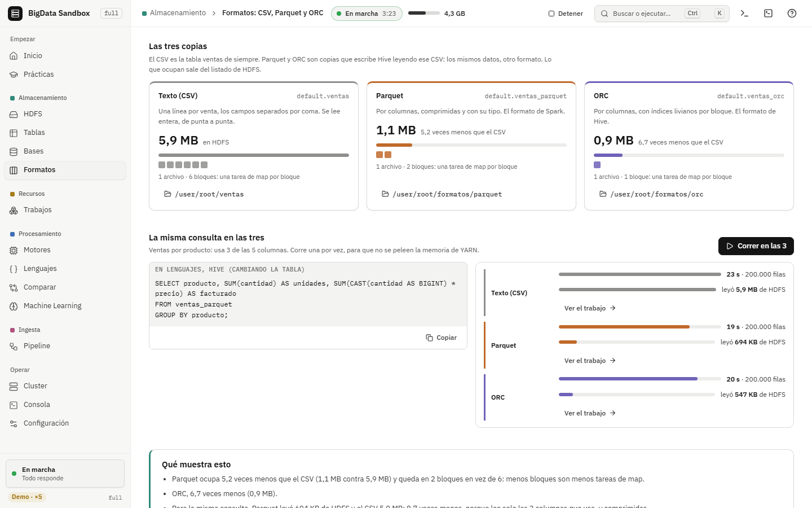

# 12. Formatos: la misma tabla en CSV, Parquet y ORC

Los datos de un data lake son archivos, y cómo están escritos importa tanto
como dónde están. Esta pantalla guarda la tabla de ventas en tres formatos y
muestra cuánto ocupa cada uno en HDFS, en cuántos bloques queda y cuánto tarda
la misma consulta. Las palabras están en el glosario:
[formato de archivo](../glosario.md#formato-de-archivo) y
[Parquet y ORC](../glosario.md#parquet-y-orc).

[← 11. Comparar](11-comparar.md) · [Índice de full](README.md) · Siguiente: [13. Estudio de ML →](13-estudio-ml.md)

La pantalla es **Formatos** (`G F`), en el grupo *Almacenamiento*. Los
comandos van **adentro** del contenedor, parado en `/datos`.



## Paso 1. Fila contra columna

**Qué se ve.** Un dibujo con las mismas cuatro ventas de dos maneras. En texto
(CSV), una línea por venta: para sumar la cantidad hay que leer cada línea
entera. Por columnas (Parquet y ORC), cada columna junta: la consulta usa
producto, cantidad y precio, y fecha y sucursal quedan marcadas con "no se
toca".

**Qué significa.** Un formato por columnas lee solo lo que la consulta usa y
comprime cada columna por separado. Una columna con pocos valores distintos
(4 sucursales, 8 productos) se guarda como un diccionario y ocupa muy poco.

## Paso 2. Las tres copias

**Qué se ve.** Una tarjeta por formato. El CSV es la tabla `ventas` de
siempre; si no existe, un aviso lleva a crearla en Lenguajes. Parquet y ORC
dicen "Todavía no existe" hasta que tocás **Crear las copias en Parquet y
ORC**.

**Qué hacer.** Tocalo. Para cada formato, Hive corre dos sentencias, y arriba
se ve en cuál va:

<!-- prueba: no (necesita SERVICIOS=todo y la tabla ventas creada) -->
```sql
CREATE EXTERNAL TABLE IF NOT EXISTS ventas_parquet (
  fecha STRING,
  sucursal STRING,
  producto STRING,
  cantidad INT,
  precio INT
)
STORED AS PARQUET
LOCATION '/user/root/formatos/parquet';
INSERT OVERWRITE TABLE ventas_parquet
SELECT * FROM ventas;
```

El `INSERT` es un trabajo de Tez que lee el CSV y escribe los mismos datos en
el formato nuevo (se ve en Trabajos). Lo mismo con `ORC` en
`/user/root/formatos/orc`.

**Qué se ve después.** Cada tarjeta muestra lo que ocupa (con cuántas veces
menos que el CSV), una barra en la misma escala para las tres, un cuadradito
por bloque, y cuántos archivos y bloques tiene su carpeta, con el botón que la
abre en HDFS.

**De dónde sale.** Del listado de HDFS de cada carpeta, la misma que anotó el
Metastore. A mano:

<!-- prueba: no (necesita las copias creadas) -->
```bash
hdfs dfs -du -s -h /user/root/ventas /user/root/formatos/parquet /user/root/formatos/orc
hdfs dfs -count /user/root/ventas /user/root/formatos/parquet /user/root/formatos/orc
```

**Qué significa.** Menos bytes son menos bloques, y cada bloque es una tarea
de map: un formato columnar no solo ocupa menos disco, también arma trabajos
más chicos.

## Paso 3. La misma consulta en las tres

**Qué se ve.** La consulta de ventas por producto (usa 3 de las 5 columnas) y
**Correr en las 3**. Corre una por vez, para que no se peleen la memoria de
YARN, y cada fila muestra cuánto tardó, cuántas filas leyó y **Ver el
trabajo**.

**Qué significa.** Con 6 MB casi todo el tiempo es arrancar el trabajo en
YARN, así que la diferencia es chica. Con cientos de GB, lo que se ahorra al
leer solo tres columnas comprimidas es la mayor parte del tiempo.

**Cuánto leyó.** Cada fila también dice cuántos bytes leyó de HDFS, con una
barra en la misma escala para las tres. Tez no guarda contadores sin el
Timeline Server: salen del resumen que imprime beeline al final de cada
consulta (`--hiveconf hive.tez.exec.print.summary=true`). Parquet y ORC
pueden leer todavía menos de lo que ocupan: solo las columnas que usa la
consulta.

## Dónde se usa esto en la industria

Casi todo data lake guarda las tablas grandes en **Parquet** (Spark,
Databricks, AWS Athena, BigQuery con tablas externas) u **ORC** (Hive). Los
formatos de tabla de hoy, **Delta Lake**, **Apache Iceberg** y **Apache
Hudi**, son Parquet por debajo más un registro de cambios. Pasar los datos
crudos en CSV o JSON a Parquet es casi siempre el primer paso de un pipeline,
como en la [guía 6](06-pipeline.md).
