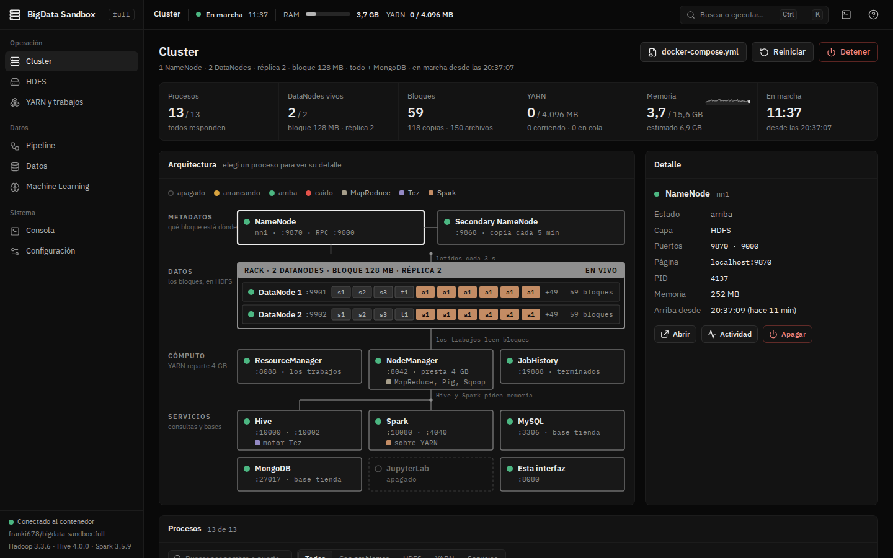

# Evaluación: operar el cluster desde la interfaz

Sobre las guías [1](../01-arrancar-y-recorrido.md),
[2](../02-cluster-y-sinoptico.md), [9](../09-configuracion-y-compose.md) y
[10](../10-consola.md), y la teoría de
[la interfaz y el cluster](../teoria/ui-y-cluster.md) y de
[observabilidad](../teoria/observabilidad.md).

[← Evaluación](README.md) · [Índice de full](../README.md)

## Opción múltiple

### 1. La lámpara de un proceso dice *arrancando*. ¿Qué sabe el servidor?

- a) Que el proceso no existe.
- b) Que el proceso corre pero su puerto todavía no escucha.
- c) Que el proceso corre y atiende pedidos.
- d) Que el proceso se cayó y se está reiniciando solo.

Respuesta

**b).** El servidor mira dos cosas: si el proceso está en `/proc/*/cmdline` y
si su puerto aparece en `/proc/net/tcp`. Proceso sin puerto es *arrancando*;
con los dos, *arriba*. Es la diferencia entre "vivo" y "listo".

- a) Sería *caído* (si debería estar) o *apagado*.
- c) Eso es *arriba*.
- d) La interfaz no reinicia procesos sola.

### 2. ¿Cuál de estas situaciones pone el cartel **Con fallas** (rojo) y no **Degradado** (ámbar)?

- a) Un DataNode caído con todas sus copias en otros nodos.
- b) Bloques con copias de menos.
- c) El ResourceManager caído.
- d) Un servicio opcional apagado.

Respuesta

**c).** Rojo es cuando se cae algo que otros necesitan: sin ResourceManager
no corre ningún trabajo. También el NameNode, MySQL, Hive o bloques sin
ninguna copia.

- a), b), d) Son ámbar: el cluster sigue sirviendo con menos margen.

### 3. ¿De dónde salen los números de **DataNodes vivos** y **Bloques** del Cluster?

- a) De `jps`.
- b) Del JMX del NameNode (`NumLiveDataNodes`, `UnderReplicatedBlocks`, `MissingBlocks`).
- c) De la API REST del ResourceManager.
- d) De contar los archivos en el disco de cada DataNode.

Respuesta

**b).** El servidor lee `FSNamesystemState` del JMX del NameNode y lo sondea
cada 2 s.

- a) `jps` lista procesos, no bloques.
- c) El RM da memoria y trabajos de YARN.
- d) El que lleva la cuenta de bloques y nodos es el NameNode.

### 4. En Configuración, la memoria estimada dice **No entra**. ¿Qué pasa si arrancás igual?

- a) La interfaz no deja arrancar.
- b) El contenedor arranca, pero algún proceso puede morir por falta de memoria.
- c) Docker le da más memoria sola.
- d) Se apagan los DataNodes de más.

Respuesta

**b).** Es una **estimación** (una suma por parte contra los 7884 MB que
Docker Desktop da por defecto en una PC de 16 GB): avisa, no impide. Lo que
conviene es bajar servicios o DataNodes, o subir la memoria de Docker.

- a) No bloquea el arranque.
- c) El límite de Docker lo cambia el usuario.
- d) No se apaga nada solo.

### 5. Cambiás la réplica con el cluster prendido. ¿Qué ofrece la barra de cambios?

- a) Aplicarlo al instante, sin reiniciar.
- b) **Aplicar y reiniciar**: el cluster se apaga y vuelve a arrancar; HDFS, las tablas y las bases quedan en el volumen.
- c) Borrar el volumen y arrancar de cero.
- d) Nada: solo se puede con el cluster apagado.

Respuesta

**b).** La configuración se usa en el arranque: con el cluster prendido hay
que reiniciarlo, y tarda alrededor de un minuto. Los datos quedan en el
volumen.

- a) La configuración es del arranque. (Para un archivo ya subido, la
  réplica se cambia en HDFS, con **Réplica**.)
- c) Empezar de cero es otra acción, aparte.
- d) Con el cluster apagado ofrece **Guardar** o **Guardar e iniciar**.

### 6. Reiniciás el contenedor. ¿Qué pasa con los eventos de la Consola?

- a) Quedan en el volumen.
- b) Se pierden: el servidor los guarda en memoria (los últimos 1000); queda lo que guardó Docker en `docker logs`.
- c) Se guardan en HDFS.
- d) Quedan en el navegador.

Respuesta

**b).** Los eventos viven en la memoria del servidor de la interfaz. Cada
uno también sale como una línea en la salida del contenedor, que es lo que
se ve con `docker logs`.

- a), c) No se persisten.
- d) Lo que queda en el navegador es el avance de las Prácticas, no la
  Consola.

### 7. ¿Cómo se entera la interfaz de un evento nuevo sin recargar la página?

- a) Recarga cada 2 s la lista entera.
- b) El servidor se lo manda por SSE (el evento `activity`).
- c) Por un WebSocket con el NameNode.
- d) Por correo.

Respuesta

**b).** El servidor empuja los cambios por Server-Sent Events; el estado del
cluster, además, se sondea cada 2 s.

- a) El sondeo es del estado, no de los eventos.
- c) La interfaz no habla con el NameNode: habla con su servidor.
- d) No.

### 8. En la Consola, un evento tiene origen *Vos*. ¿Qué significa?

- a) Que lo escribió el usuario en la terminal del contenedor.
- b) Que es una acción que hiciste desde la interfaz.
- c) Que es un error.
- d) Que lo informó el NameNode.

Respuesta

**b).** Separa lo que hiciste vos desde la interfaz de lo que hizo el cluster
solo (*Cluster*, un proceso como *DataNode 2*). Lo que escribís en la
terminal no pasa por la interfaz y no aparece.

- a) La Consola no ve la terminal.
- c) La gravedad es otro dato (info, ok, warn, error).
- d) Eso tendría el nombre del proceso como origen.

## Desarrollo

### 1. Explicá la diferencia entre que un proceso esté vivo y que esté listo, con un ejemplo del sandbox.

Respuesta modelo

Vivo (*liveness*) es que el proceso exista; listo (*readiness*) es que
pueda atender. Un NameNode recién lanzado ya está en la lista de procesos
pero tarda en abrir su puerto (y después en salir del modo seguro). La
interfaz lo muestra con dos lámparas distintas: *arrancando* (proceso sin
puerto) y *arriba* (proceso con puerto escuchando). Si se mirara solo el
proceso, se mandarían pedidos a algo que todavía no contesta. En Kubernetes
es la diferencia entre la *liveness probe* y la *readiness probe*.

Rúbrica: las dos definiciones (2), el ejemplo (2), cómo lo muestra la
interfaz (1).

### 2. ¿Qué parte de lo que muestra la interfaz es medido y qué parte es deducido? Dá dos ejemplos de cada uno.

Respuesta modelo

**Medido**: el estado de los procesos (de `/proc`), los DataNodes vivos y
los bloques (JMX del NameNode), la memoria de YARN (REST del
ResourceManager), la memoria del contenedor (cgroup). **Deducido** por la
interfaz: los carteles Degradado / Con fallas (los arma con lo que trae el
estado), la columna **Lo escribió** de HDFS (por la ruta y el nombre), la
memoria estimada de Configuración (una suma por parte), el DAG de Tez (de lo
que imprime `beeline`, porque no hay Timeline Server). Importa porque lo
deducido puede equivocarse aunque los datos estén bien.

Rúbrica: dos medidos con su fuente (2), dos deducidos con su regla (2), por
qué importa la diferencia (1).

### 3. ¿Por qué la Consola no alcanza como log de auditoría en una empresa?

Respuesta modelo

Porque guarda solo los últimos 1000 eventos y en memoria (se pierden al
reiniciar), registra solo lo que pasa por la interfaz (no lo que alguien
hace en una terminal) y no dice qué persona lo hizo (todo es *Vos*). Un log
de auditoría tiene que ser completo, durable, a prueba de borrado y con la
identidad de quien actuó; en Hadoop eso es el *audit log* del NameNode,
centralizado con herramientas como Apache Ranger.

Rúbrica: tres limitaciones (3), qué tendría que tener (1), ejemplo de
herramienta (1).

## Ejercicios sobre la interfaz

### Ejercicio 1. Leer el arranque

Con el volumen vacío, arrancá el cluster con `SERVICIOS=todo` y quedate en
el panel **Arranque**. Anotá: (a) los pasos que aparecieron, (b) los que se
saltearon y por qué, (c) el comando del paso de los DataNodes que espera a
HDFS y (d) cuánto tardó contra lo esperado.

Solución

(a) Formatear HDFS, NameNode y Secondary, DataNodes, Carpetas en HDFS, YARN
y JobHistory, MySQL, Librerías de Tez y Spark, Hive, Spark History Server,
JupyterLab (si está prendido) y Esta interfaz. (b) ZooKeeper y JournalNodes
no aparecen sin alta disponibilidad; MongoDB, si está apagado. En un segundo
arranque se saltean Formatear ("el volumen ya tiene datos"), Carpetas ("ya
existen") y Librerías ("ya están en HDFS"). (c) `hdfs dfsadmin -safemode
wait`. (d) La barra muestra el tiempo que va contra el esperado; el primer
arranque tarda unos 2 minutos.

Rúbrica: (a) 2 puntos, (b) 2, (c) 1, (d) 1.

### Ejercicio 2. Diagnosticar con la Consola

Apagá un DataNode desde Cluster y, sin mirar el sinóptico, reconstruí qué
pasó solo con la Consola: filtrá *Problemas*, abrí el evento, usá **Sólo
eventos de este proceso** y contá la historia en orden.

Solución

Con el filtro de origen *Vos* aparece la acción de apagar, con su comando.
Con *Problemas*, el aviso "DataNode N se apagó" (warn). **Sólo eventos de
este proceso** muestra la historia del DataNode sola: cuándo arrancó y
cuándo se apagó. Si después lo prendés, aparece "DataNode N arriba" (ok). La
historia se lee del síntoma (el aviso) a la causa (la acción de *Vos*).

Rúbrica: encuentra la acción de *Vos* (1), el aviso (1), usa el filtro por
proceso (1), cuenta la historia en orden (2).

### Ejercicio 3. Hacer entrar la configuración

En Configuración, subí los DataNodes a 5 con `SERVICIOS=todo`, MongoDB y
JupyterLab prendidos. Abrí **Ver de dónde sale** y verificá la suma. ¿Entra
en 7,7 GB? Proponé dos cambios para que entre con margen y mostrá la nueva
suma.

Solución

La suma con 1 NameNode: 4096 (HDFS y sistema) + 4 × 256 (DataNodes más allá
del primero) + 1024 (YARN, MapReduce y MySQL) + 1024 (Hive y Spark) + 512
(MongoDB) + 384 (JupyterLab) + 128 (interfaz) = 8192 MB, más que los 7884
del límite: **No entra**. Por ejemplo, apagando MongoDB y JupyterLab queda
8192 − 512 − 384 = 7296 MB; el cartel pasa a **Entra justo**, porque es más
del 85 % del límite (6701 MB). Para que entre con margen hay que bajar más:
por ejemplo, volver a 3 DataNodes (6784 MB) sigue justo; con
`SERVICIOS=mapreduce` (sin Hive ni Spark) y 3 DataNodes, sin MongoDB ni
JupyterLab: 4096 + 512 + 1024 + 128 = 5760 MB, con margen.

Rúbrica: suma inicial bien (2), lee el cartel (1), dos cambios con la nueva
suma (2), entiende el umbral del 85 % (1).

